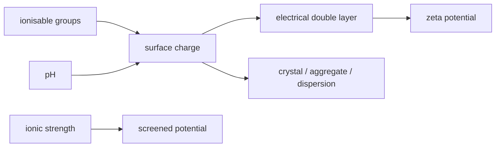

# Surface Charge

## In one paragraph
Surface charge is the net and patterned electrical charge exposed at a biomolecule, nanoparticle or interface. The lectures use it for protein redesign, electrical double layers, zeta potential and protein-container crystallisation: charged residues or ligands alter solubility, colloid stability and assembly contacts [L2, pp.9–12; L5, pp.9–10; L6, p.21; L11, pp.2–3].

## The physics
A simple charge-counting model is:

$$q_{\mathrm{surf}}=e\sum_i z_i$$

| Symbol | Meaning | Units / notes |
|---|---|---|
| $q_{\mathrm{surf}}$ | net surface charge | C |
| $e$ | elementary charge | C |
| $z_i$ | charge number of group $i$ | dimensionless; pH-dependent |
| $i$ | surface residue, ligand or ionisable group | dimensionless index |

Assumptions and validity limits: this is a bookkeeping model, not a full electrostatic potential. Real charge depends on pH, ionic strength, local p$K_a$, adsorbed ions, [[ligand-shell]] composition and the [[electrical-double-layer]]. Lecture 6 reports that $\zeta<-30$ mV or $\zeta>+30$ mV indicates stable colloids, while $\zeta\approx0$ mV near the isoelectric point lowers stability [L6, p.21].

*Takeaway: solution conditions convert surface charge into screening, mobility and assembly behaviour [L6, p.21; L11, pp.2–3].*

## Typical orders of magnitude
- Zeta-potential stability rule: beyond about $\pm30$ mV stable; near 0 mV unstable/near pI [L6, p.21].
- Debye lengths are nm-scale under typical electrolyte conditions (outside the lecture material).
- Protein and nanoparticle surfaces are nm-scale; lecture 11 shows charge-pattern redesign on ferritin-like containers [L11, pp.2–3].

## Connections
Connects [[zeta-potential]], [[isoelectric-point]], [[debye-length-slipping-plane]], [[electrical-double-layer]], [[nanoparticle-stabilization]], [[rosetta-protein-design]] and [[protein-crystal-nanoparticle-superlattices]].
