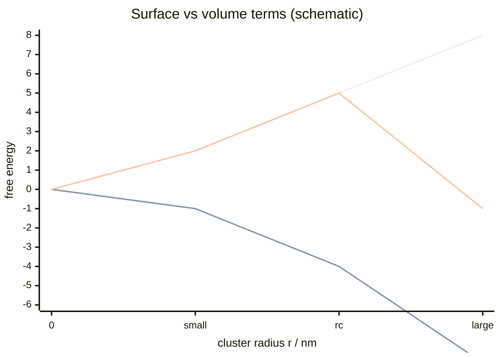

# Surface Energy

## In one paragraph
Surface energy is the energetic cost of creating interface. In lecture 5 it is the positive term in [[classical-nucleation-theory]] and the reason nanoparticles aggregate, coalesce or ripen unless stabilised; lecture 9 returns to the same competition when organisms control mineral nucleation and growth [L5, pp.7–8; L9, pp.12–13].

## The physics
For a spherical nucleus, lecture 5 writes:

$$\Delta G(r)=4\pi r^2\gamma+\frac{4}{3}\pi r^3\Delta G_v$$

| Symbol | Meaning | Units / notes |
|---|---|---|
| $\Delta G(r)$ | free energy to form a radius-$r$ cluster | J |
| $r$ | cluster radius | m, often nm |
| $\gamma$ | surface energy / interfacial tension | J m$^{-2}$ |
| $\Delta G_v$ | bulk free-energy change per volume | J m$^{-3}$; negative in supersaturation |

Assumptions and validity limits: spherical homogeneous nuclei, one effective $\gamma$, continuum interface and no ligand-specific facets. The lecture uses the model qualitatively to explain critical size and why particles reduce surface energy by aggregation, coalescence or Ostwald ripening [L5, pp.7–8].

*Takeaway: high surface energy penalises tiny clusters until supersaturation makes the bulk term dominate [L5, p.7].*

## Typical orders of magnitude
- Nanoparticle interfaces are nm-scale; therefore surface-to-volume ratio is large [L5, p.6].
- Energies are usually discussed in $k_BT$ or kJ mol$^{-1}$; lecture 5 does not give a numerical $\gamma$.
- Ligands, electrical double layers and steric shells lower aggregation tendency [L5, pp.8–10].

## Connections
Linked to [[classical-nucleation-theory]], [[supersaturation]], [[activation-energy]], [[coalescence-ostwald-ripening]], [[nanoparticle-stabilization]] and [[ligand-shell]].
