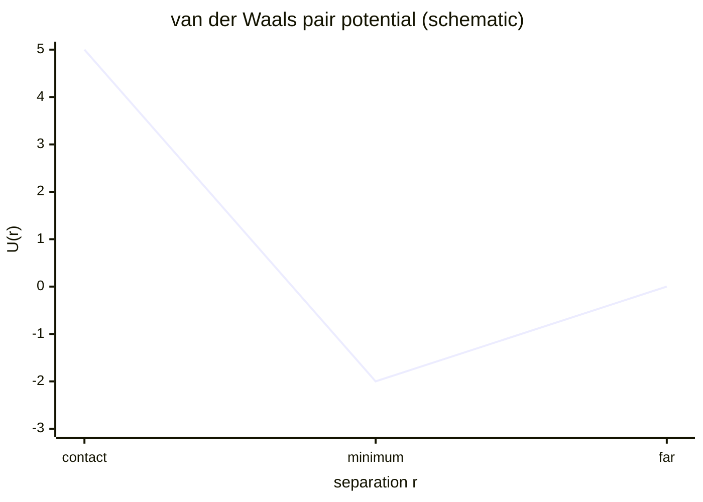

# Van der Waals Interactions

## In one paragraph
Van der Waals interactions are weak short-range attractions and repulsions between atoms, molecules or nanoparticles. The lectures mention them as part of protein-folding enthalpy, Rosetta scoring and hydrophobic-ligand-driven nanoparticle aggregation/assembly [L1, p.3; L2, p.11; L11, pp.1–2].

## The physics
A standard pair potential is the Lennard-Jones form:

$$U(r)=4\varepsilon\left[\left(\frac{\sigma}{r}\right)^{12}-\left(\frac{\sigma}{r}\right)^6\right]$$

| Symbol | Meaning | Units / notes |
|---|---|---|
| $U(r)$ | interaction energy at separation $r$ | J or kJ mol$^{-1}$ |
| $\varepsilon$ | well depth | J or kJ mol$^{-1}$ |
| $\sigma$ | distance where $U=0$ | m or nm |
| $r$ | centre-to-centre separation | m or nm |

Assumptions and validity limits: this equation is outside the lecture material; it is a simple nonbonded atom-pair model. In real proteins and colloids, solvent, salt, surface roughness and many-body effects matter. Lecture 2 treats van der Waals as one Rosetta energy term rather than a standalone observable [L2, p.11].

*Takeaway: vdW contacts are weak individually but become important when many surface atoms contact [L1, p.3; L11, pp.1–2].*

## Typical orders of magnitude
- Individual contacts are near $k_BT$ scale (outside the lecture material); in proteins many contacts contribute kJ mol$^{-1}$ to folding.
- For nanoparticles, vdW attraction competes with electrostatic and steric repulsion in aggregation [L5, pp.8–10; L11, pp.1–2].
- The lecture does not give Hamaker constants or numerical vdW well depths.

## Connections
Related to [[protein-folding-thermodynamics]], [[hydrophobic-effect]], [[nanoparticle-stabilization]], [[ligand-shell]], [[surface-energy]] and [[biohybrid-conductive-materials]].
