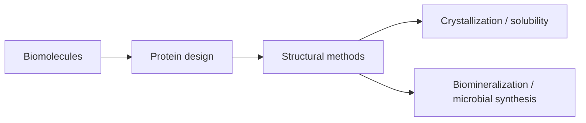

# Glossary

*Takeaway: the glossary terms cluster around biomolecular building blocks, engineering, structural measurement, solubility and biological mineral formation.*

- **Active site** — amino-acid arrangement where a substrate binds and reacts in [[enzyme-catalysis]].
- **Affinity chromatography** — purification by specific binding to a ligand or tag; see [[affinity-chromatography]].
- **Amino acid** — protein building block with amino, carboxyl and side-chain groups; see [[amino-acids-peptides]].
- **Biohybrid material** — material combining biological and non-biological components; see [[biohybrid-materials]].
- **Bragg law** — diffraction condition $2d\sin\theta=n\lambda$; see [[bragg-law]].
- **Bravais lattice** — translational lattice with identical surroundings at every lattice point; see [[bravais-lattices]].
- **CASP** — benchmark for protein-structure prediction; see [[casp]].
- **Chaotrope** — weakly hydrated ion that can destabilise proteins; see [[chaotropic-kosmotropic-ions]].
- **Coherent X-ray imaging (CXI)** — lensless reconstruction from coherent diffraction; see [[coherent-x-ray-imaging]].
- **Cryo-EM pipeline** — vitrification, low-dose imaging, image processing and reconstruction; see [[cryo-em]].
- **Cryo-EM** — structure method using frozen hydrated samples; see [[cryo-em]].
- **Directed evolution** — iterative mutation and selection; see [[directed-evolution]].
- **FPLC** — automated chromatography platform with flow/gradient control; see [[fplc]].
- **GFP** — green fluorescent protein, used as a surface-charge/stability redesign example; see [[green-fluorescent-protein]].
- **Hydrophobic effect** — water-mediated tendency to bury nonpolar residues; see [[protein-folding-thermodynamics]].
- **Ion exchange chromatography** — separation by protein charge; see [[ion-exchange-chromatography]].
- **Kosmotrope** — strongly hydrated ion that structures water and can promote salting out; see [[chaotropic-kosmotropic-ions]].
- **Peptide bond** — amide bond joining amino acids; see [[amino-acids-peptides]].
- **Protein cage** — symmetric protein nanocontainer with interior/exterior functions; see [[protein-cages]].
- **Protein crystallography** — structure determination from protein crystals and X-ray diffraction; see [[protein-crystallography]].
- **Reciprocal space** — Fourier-space representation of diffraction data; see [[reciprocal-space-fourier-transform]].
- **Rosetta** — computational protein-design/scoring suite; see [[rosetta-protein-design]].
- **Salting in/out** — salt-induced increase/decrease of protein solubility; see [[salting-in-salting-out]].
- **Size exclusion chromatography** — separation by hydrodynamic size; see [[size-exclusion-chromatography]].
- **Space group** — point group plus lattice translations; see [[crystallographic-symmetry]].
- **X-ray diffraction** — scattering of X-rays by crystal electron density; see [[x-ray-diffraction]].

- **Apoferritin** — empty ferritin shell used as a size-constrained nanoreactor; see [[apoferritin]].
- **Biomineralization** — biological control of mineral nucleation, growth and composite formation; see [[biomineralization]].
- **Biomineral** — natural organic/inorganic hierarchical composite such as bone or shell; see [[biominerals]].
- **Controlled nucleation and growth** — regulation of crystal formation by temperature, supersaturation, diffusion, kinetics and templates; see [[controlled-nucleation-growth]].
- **Curli fiber** — E. coli extracellular amyloid-like fiber used as a peptide-tagged assembly scaffold; see [[curli-fibers]].
- **EDX** — electron-beam-induced characteristic X-ray analysis; see [[energy-dispersive-x-ray-spectroscopy]].
- **EELS** — measurement of electron energy loss after inelastic scattering; see [[electron-energy-loss-spectroscopy]].
- **Electron microscopy** — imaging/spectroscopy platform using accelerated electrons; see [[electron-microscopy]].
- **Ferritin** — iron-storage protein cage with ferroxidase and nucleation functions; see [[ferritin]].
- **M13 bacteriophage** — filamentous E. coli phage used as a peptide-display nanomaterial template; see [[m13-bacteriophage]].
- **Microbial nanomaterial synthesis** — formation of nanomaterials inside or around living cells; see [[microbial-nanomaterial-synthesis]].
- **Nanoparticle drug delivery** — nanocarriers for cargo loading, targeting, release and theranostics; see [[nanoparticle-drug-delivery]].
- **SEM** — surface-sensitive scanned electron imaging with secondary/backscattered electrons; see [[scanning-electron-microscopy]].
- **SERS** — surface-enhanced Raman detection using plasmonic hot spots; see [[sers-biosensing]].
- **SFX** — serial femtosecond crystallography using XFEL pulses on many micro/nanocrystals; see [[serial-femtosecond-crystallography]].
- **Shewanella oneidensis** — metal-reducing bacterium used for extracellular mineral formation; see [[shewanella-oneidensis]].
- **Synchrotron radiation** — bright tunable X-rays from relativistic electrons in magnetic fields; see [[synchrotron-radiation]].
- **TEM** — transmitted-electron imaging of thin samples; see [[transmission-electron-microscopy]].
- **XANES** — near-edge X-ray absorption spectroscopy for oxidation/electronic environment; see [[x-ray-absorption-near-edge-structure]].
- **XFEL** — femtosecond high-brilliance X-ray pulse source; see [[x-ray-free-electron-laser]].
- **XRF** — element-specific X-ray fluorescence mapping; see [[x-ray-fluorescence-spectroscopy]].

- **AlphaFold** — AI structure prediction from sequence/MSA; see [[alphafold]].
- **Classical nucleation theory** — surface/bulk free-energy model for critical nuclei; see [[classical-nucleation-theory]].
- **Coalescence** — nanoparticle growth by collision and merging; see [[coalescence-ostwald-ripening]].
- **Debye length** — electrostatic screening length around charged surfaces; see [[electrical-double-layer]].
- **DLS** — dynamic light scattering for hydrodynamic size; see [[dynamic-light-scattering]].
- **Electrical double layer** — ionic structure at charged surface/electrolyte interface; see [[electrical-double-layer]].
- **Form factor** — single-particle SAXS contribution from size and shape; see [[saxs-form-structure-factor]].
- **Gold nanoparticle** — citrate/ligand-stabilised plasmonic Au colloid; see [[gold-nanoparticles]].
- **Guinier analysis** — low-$q$ SAXS method for $R_g$; see [[guinier-analysis]].
- **Ligand exchange** — replacement/modification of nanoparticle surface ligands; see [[ligand-exchange]].
- **Nanoparticle** — mesoscale particle between molecules and bulk matter; see [[nanoparticles]].
- **Ostwald ripening** — growth of larger particles at the expense of smaller ones; see [[coalescence-ostwald-ripening]].
- **PDI** — polydispersity index for distribution breadth; see [[polydispersity-index]].
- **Phase problem** — missing diffraction phases required for electron-density maps; see [[phase-problem]].
- **Phage display** — expression of peptide libraries on phage surfaces for binding selection; see [[phage-display]].
- **Plasmonic supercrystal** — ordered nanoparticle superlattice with collective plasmonic coupling; see [[plasmonic-supercrystals]].
- **ProteinMPNN** — inverse protein-design method from structure to sequence; see [[protein-mpnn]].
- **Ramachandran plot** — $\phi/\psi$ backbone-angle validation plot; see [[ramachandran-plot]].
- **SANS** — small-angle neutron scattering with isotope contrast; see [[sans-contrast-variation]].
- **SAXS** — small-angle X-ray scattering for nanoscale size/shape; see [[small-angle-x-ray-scattering]].
- **Steric stabilisation** — bulky ligand/polymer shells preventing close approach; see [[steric-stabilization]].
- **Structure factor** — diffraction/scattering term containing phase or interparticle arrangement; see [[structure-factor]] and [[saxs-form-structure-factor]].
- **Zeta potential** — potential at the slipping plane indicating colloid stability; see [[zeta-potential]].
- **AFM** — force-based surface microscopy using cantilever deflection; see [[atomic-force-microscopy]].
- **DNA origami** — programmed folding of a long scaffold DNA by staple strands; see [[dna-origami]].
- **EBL** — focused electron-beam writing of nanoscale resist patterns; see [[electron-beam-lithography]].
- **Langmuir-Blodgett film** — transferred compressed amphiphile monolayer; see [[langmuir-blodgett-films]].
- **Plasmon-exciton coupling** — hybrid optical interaction between metallic plasmons and excitons; see [[plasmon-exciton-coupling]].
- **SAM** — self-assembled monolayer formed from surface-active molecules; see [[self-assembled-monolayers]].
- **siRNA delivery** — nanocarrier-mediated transport of gene-silencing RNA; see [[sirna-delivery]].
- **STM** — tunnelling-current surface microscopy; see [[scanning-tunneling-microscopy]].
- **Superhydrophobicity** — extreme water repellency from chemistry plus roughness; see [[superhydrophobicity-lotus-effect]].
- **Activation energy** ? barrier lowered by enzymes and appearing in nucleation-rate expressions; see [[activation-energy]].
- **Brownian motion** ? random thermal motion whose DLS fluctuation rate gives diffusion and size; see [[brownian-motion]].
- **Debye length and slipping plane** ? screening distance and hydrodynamic boundary that define zeta-potential measurements; see [[debye-length-slipping-plane]].
- **Electron density** ? Fourier-reconstructed crystallographic map into which atomic models are fitted; see [[electron-density]].
- **Hydrophobic effect** ? water-entropy-driven burial of nonpolar surfaces; see [[hydrophobic-effect]].
- **Isoelectric point** ? pH where net charge approaches zero and colloidal/protein stability can drop; see [[isoelectric-point]].
- **Ligand shell** ? headgroup/spacer/terminal molecular layer around a nanoparticle core; see [[ligand-shell]].
- **Localized surface plasmon resonance** ? collective metal-electron oscillation causing Au NP colour, hot spots and heating; see [[localized-surface-plasmon-resonance]].
- **Nanotoxicity** ? biological risk governed by nanoscale size, surface, material, dose and clearance; see [[nanotoxicity]].
- **Photothermal therapy** ? light-to-heat treatment using nanoscale absorbers such as Au or CuS systems; see [[photothermal-therapy]].
- **Supersaturation** ? solute excess over equilibrium solubility that drives nucleation/growth; see [[supersaturation]].
- **Surface charge** ? exposed net/patterned charge controlling double layers, pI, zeta potential and assembly; see [[surface-charge]].
- **Surface energy** ? interfacial free-energy penalty opposed by bulk driving force in nucleation; see [[surface-energy]].
- **Theranostics** ? combined therapeutic and diagnostic nanocarrier design; see [[theranostics]].
- **Van der Waals interactions** ? weak nonbonded contacts important collectively in proteins and colloids; see [[van-der-waals-interactions]].
