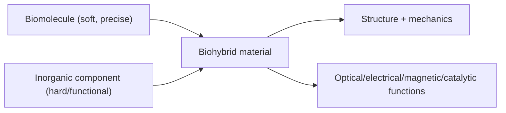
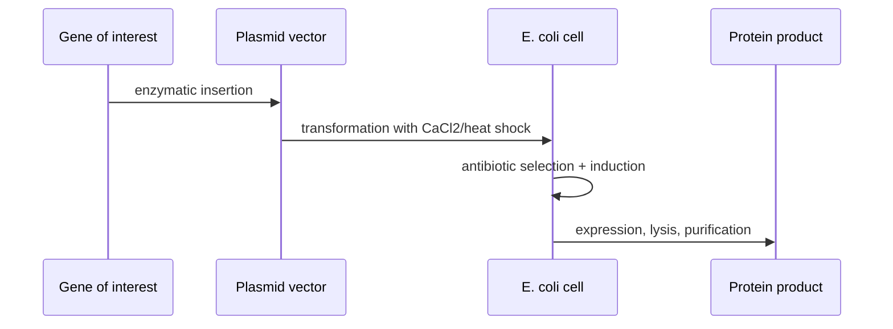
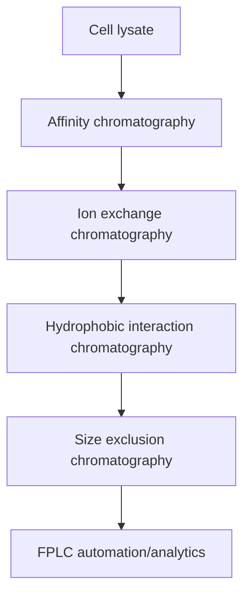

---
title: Biomolecules and Recombinant Protein Production
type: lecture
tags: [biomolecules, proteins, recombinant-expression, chromatography]
lectures: [L01]
updated: 2026-10-19
status: draft
---

# Lecture 1 — Biomolecules and Recombinant Protein Production

> Source: `raw/biohybrid_nanostructures_1_2_3.pdf`, pp. 1–6 and p. 8. Page 8 is filed here because its highlighted header says **Wdh 1** and the content continues protein purification, even though it appears after a Wdh 2 page in the scan order.

## In one paragraph
Lecture 1 defines [[biohybrid-materials]] as combinations of biological components with synthetic polymers, ceramics, metals, metal oxides or other inorganic parts, then contrasts natural biological materials with artificial biohybrids. Biomolecules such as [[proteins]], [[dna-rna]], carbohydrates and lipids provide defined 3D structures, atomic precision, softness, repairability and limited elemental composition (C/H/N/O/S), while inorganic components add optical, electrical, magnetic or catalytic properties but are harder to assemble and often not atomically precise [L1, p.1]. The lecture then focuses on [[protein-structure]], [[amino-acids-peptides]], folding, the [[genetic-code-central-dogma]], recombinant expression in *E. coli*, cell lysis and purification by [[affinity-chromatography]], [[ion-exchange-chromatography]], [[hydrophobic-interaction-chromatography]], [[size-exclusion-chromatography]] and [[fplc]] [L1, pp.2–6,8].

## Key concepts
- [[biohybrid-materials]] — coupling soft/hard, biological/inorganic components to obtain new properties [L1, p.1].
- [[biomolecules]] — carbohydrates, nucleic acids, proteins and lipids organised as monomers, polymers and cellular structures [L1, p.2].
- [[protein-structure]] — hierarchy from sequence to quaternary assembly [L1, p.2].
- [[amino-acids-peptides]] — chirality, charged/polar/hydrophobic/special residues and peptide bonds [L1, pp.2–4].
- [[protein-folding-thermodynamics]] — hydrophobic collapse and $\Delta G = \Delta H - T\Delta S$ control folding [L1, p.3].
- [[genetic-code-central-dogma]] and [[dna-rna]] — transcription, translation and degeneracy of codons [L1, p.3].
- [[recombinant-protein-production]] — plasmid vector, transformation, antibiotics, inducer and purification [L1, pp.5–6].
- Chromatography methods: [[affinity-chromatography]], [[ion-exchange-chromatography]], [[hydrophobic-interaction-chromatography]], [[size-exclusion-chromatography]], [[fplc]] [L1, pp.6,8].

## The chemistry / physics

### Peptide-bond formation
Amino acids polymerise when the carboxyl group of one residue condenses with the amino group of the next:

$$
\mathrm{H_2N{-}CHR_1{-}COOH + H_2N{-}CHR_2{-}COOH \rightarrow H_2N{-}CHR_1{-}CO{-}NH{-}CHR_2{-}COOH + H_2O}
$$

| Symbol / term | Meaning | Units / notes |
|---|---|---|
| $R_1, R_2$ | Amino-acid side chains | chemical groups |
| $\mathrm{CO{-}NH}$ | Peptide bond | planar, partial double-bond character |
| $\mathrm{H_2O}$ | Condensation product | one water per bond |

Assumption: this is the net chemical stoichiometry; in cells ribosomes form peptide bonds by activated aminoacyl-tRNAs, not by direct uncatalysed dehydration [L1, pp.2–3].

### Folding free energy
The scans explicitly state that folded protein structure is energetically favoured when:

$$
\Delta G = \Delta H - T\Delta S < 0
$$

| Symbol | Meaning | Units / typical scale |
|---|---|---|
| $\Delta G$ | Gibbs free-energy change for folding | kJ mol$^{-1}$; often a few to tens of kJ mol$^{-1}$ |
| $\Delta H$ | Enthalpy from H-bonds, van der Waals and electrostatic interactions | kJ mol$^{-1}$ |
| $T$ | Absolute temperature | K; room temperature $\approx 298$ K |
| $\Delta S$ | Entropy change; includes chain entropy and water entropy | J mol$^{-1}$ K$^{-1}$ |

Validity limits: a two-state folded/unfolded picture is a simplification; aggregation and intermediate states are not represented. The lecture emphasises that burying hydrophobic residues releases ordered water molecules and gives an entropic gain [L1, p.3].

## Diagrams

*Takeaway: the first design rule is to combine the precision of biomolecules with functions from inorganic matter [L1, p.1].*

*Takeaway: recombinant production couples genetic cloning to cell growth and downstream purification [L1, pp.5–6].*

*Takeaway: the lecture presents purification as a multi-step trade-off among speed, resolution, recovery and capacity [L1, pp.6,8].*

## Worked numbers / orders of magnitude
- Protein purification manipulates nm-scale folded objects (typical globular proteins roughly 2–10 nm; outside the lecture material) with solution conditions such as pH, salt concentration and inducer concentration [L1, p.8].
- Amino acids are chiral; natural proteins use L-amino acids, while D-peptides are noted as pharmaceutically interesting because they resist proteases/hydrolysis and may show reduced immunogenicity [L1, p.4].
- Chromatographic bands are separated by affinity, charge, hydrophobic regions or size; blue/red charge cartoons in the notes mark positive vs negative proteins [L1, p.6].

## Connections
- Builds the biomolecular foundation for [[enzyme-catalysis]] and [[rational-protein-design]] in [[L02]].
- Provides purification concepts used again when [[protein-crystallization-phase-diagram]] is discussed in [[L03]].

## Uncertain or illegible
- Page 8 appears after the first Wdh 2 page but is headed Wdh 1; assigned to L01 by header/content, with the ordering ambiguity also recorded in [[open-questions]].
- The lower-right D/L stereochemistry drawings on p.4 are legible in concept but not all atom labels are clear; no detailed stereochemical mechanism is inferred beyond L- vs D-peptides.
