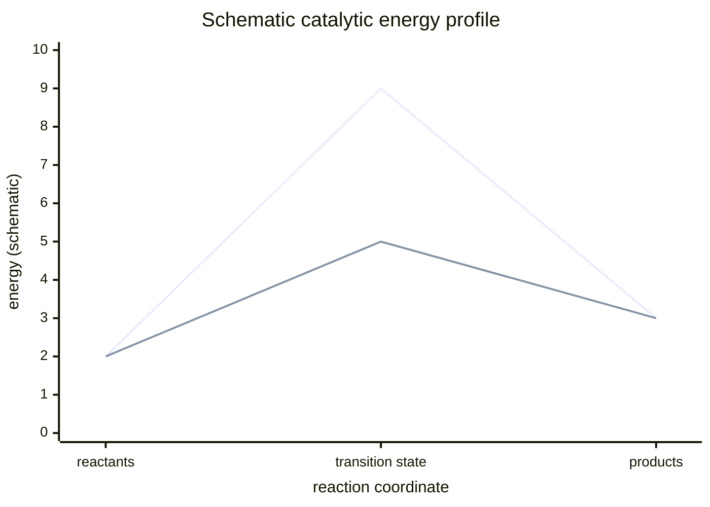

---
title: Enzyme Catalysis and Protein Design
type: lecture
tags: [enzymes, protein-design, directed-evolution, rosetta]
lectures: [L02]
updated: 2026-10-19
status: draft
---

# Lecture 2 — Enzyme Catalysis and Protein Design

> Source: `raw/biohybrid_nanostructures_1_2_3.pdf`, pp. 7 and 9–12. Page 8 in the scan order is excluded from this lecture because its highlighted header says Wdh 1 and it continues lecture-1 chromatography.

## In one paragraph
Lecture 2 moves from producing proteins to designing proteins. It begins with [[enzyme-catalysis]]: catalysts lower activation energy, active sites bind substrates, enzymes have high turnover numbers, and the suffix **-ase** marks many enzymes [L2, p.7]. It then introduces [[rational-protein-design]] and [[rosetta-protein-design]] as computational design routes in which transition-state geometries, Theozyme models, pocket repacking and scaffold matching are combined with experimental testing [L2, pp.7,9]. [[directed-evolution]] supplies the complementary laboratory route: repeated mutation, expression, screening/selection and amplification improves function without solving the design problem from first principles [L2, pp.7,12]. The lecture uses [[protein-cages]], [[green-fluorescent-protein]], [[designed-ankyrin-repeat-proteins]] and surface-charge redesign as examples of protein-based scaffolds and functional redesign [L2, pp.9–12].

## Key concepts
- [[enzyme-catalysis]] — enzymes lower activation barriers and stabilise transition states [L2, p.7].
- [[rational-protein-design]] — uses structural knowledge and modelling to design properties/functions [L2, p.9].
- [[rosetta-protein-design]] — computational toolkit; CASP benchmarking is mentioned [L2, p.10].
- [[directed-evolution]] — mutation and selection of variants with desired function [L2, pp.7,12].
- [[protein-cages]] — protein-based nanostructures with interiors/exteriors usable for encapsulation and display [L2, p.9].
- [[green-fluorescent-protein]] — charge and thermostability redesign example [L2, pp.9,11–12].
- [[designed-ankyrin-repeat-proteins]] — alternative binding scaffolds built from repeat proteins [L2, p.11].

## The chemistry / physics

### Catalytic lowering of an activation barrier
The notes show an energy diagram where a catalysed path has a lower activation energy than an uncatalysed path [L2, p.7]. A schematic rate constant can be written as:

$$
k \propto \exp\left(-\frac{\Delta G^{\ddagger}}{RT}\right)
$$

| Symbol | Meaning | Units / typical scale |
|---|---|---|
| $k$ | Reaction rate constant | depends on reaction order |
| $\Delta G^{\ddagger}$ | Activation free energy | kJ mol$^{-1}$ |
| $R$ | Gas constant | 8.314 J mol$^{-1}$ K$^{-1}$ |
| $T$ | Temperature | K |

Lowering $\Delta G^{\ddagger}$ by even 5.7 kJ mol$^{-1}$ changes a rate by about tenfold at 298 K (outside the lecture material). This equation captures the lecture drawing but does not specify the detailed enzyme mechanism.

### Surface redesign energy terms
Rosetta redesign is summarised in the notes as a total energy containing van der Waals, electrostatic, solvation, hydrogen-bond and reference terms, with a unique cost for each residue type [L2, p.11]:

$$
E_{\mathrm{total}} = \sum_i \left(E_{\mathrm{vdW},i}+E_{\mathrm{elec},i}+E_{\mathrm{solv},i}+E_{\mathrm{Hbond},i}+E_{\mathrm{ref},i}\right)
$$

| Symbol | Meaning | Units / notes |
|---|---|---|
| $E_{\mathrm{total}}$ | Scored model energy | Rosetta energy units, not direct SI |
| $i$ | Residue or interaction index | dimensionless |
| $E_{\mathrm{vdW}}$ | Steric/dispersion contribution | model term |
| $E_{\mathrm{elec}}$ | Electrostatic contribution | model term |
| $E_{\mathrm{solv}}$ | Solvation/desolvation contribution | model term |
| $E_{\mathrm{Hbond}}$ | Hydrogen-bond contribution | model term |
| $E_{\mathrm{ref}}$ | Residue-type reference energy | model term |

Validity limits: this is a computational scoring model, not a fundamental thermodynamic equation. The lecture notes stress experimental testing remains necessary [L2, p.10].

## Diagrams

*Takeaway: catalysis lowers the transition-state barrier, not the reactant/product energies [L2, p.7].*

*Takeaway: rational design is an iterative computational-plus-experimental workflow [L2, pp.7,10].*

*Takeaway: directed evolution searches sequence space by mutation and selection rather than explicit design [L2, pp.7,12].*

## Worked numbers / orders of magnitude
- Protein cages are described as symmetric nanostructures with inside/outside compartments and roughly protein-sized building blocks; one example notes a cowpea cage of about 31 nm [L2, p.9].
- GFP redesign examples compare charge variants such as HActS-neg, GFP-R10 and GFP(+36), plus supercharged variants stable/recovering fluorescence after heating near 100 °C [L2, pp.9,12].
- Rosetta CASP benchmarking is noted as structure-prediction assessment with fragment assembly and deep-learning/Rosetta synergy [L2, p.10].

## Connections
- Uses [[protein-structure]], [[amino-acids-peptides]] and [[recombinant-protein-production]] from [[L01]].
- Surface redesign and crystallisation motivate the structural methods and crystal concepts in [[L03]].

## Uncertain or illegible
- The exact handwritten phrase beside the p.7 enzyme example appears to be “enzyme designed with Rosetta to catalyse cleavage of aldol product”; the specific substrate/product name is not fully legible.
- The page-order mismatch involving p.8 is recorded in [[open-questions]].
