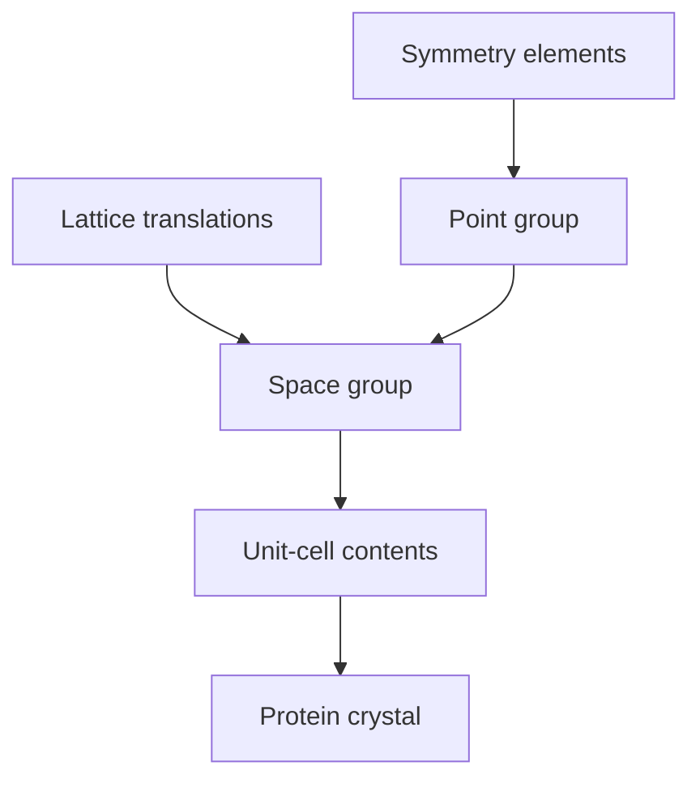
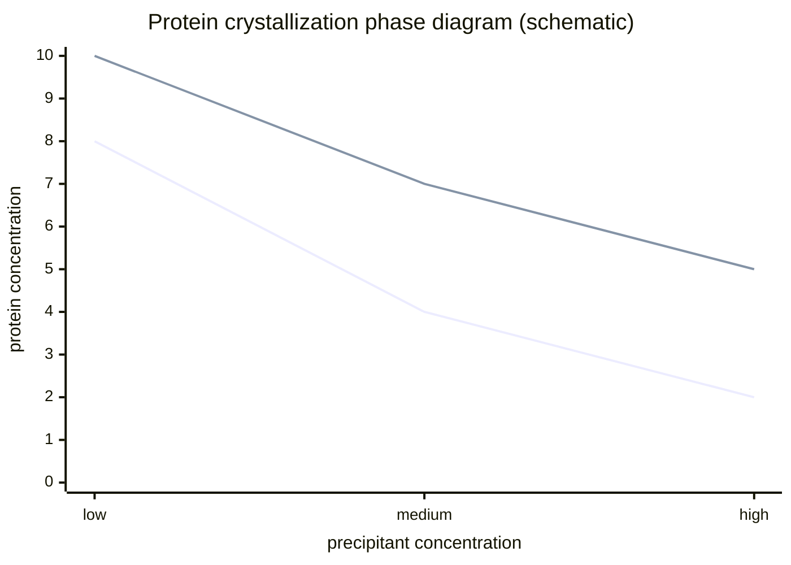

---
title: Protein Crystallography and Protein Solubility
type: lecture
tags: [crystallography, symmetry, diffraction, solubility]
lectures: [L03]
updated: 2026-10-19
status: draft
---

# Lecture 3 — Protein Crystallography and Protein Solubility

> Source: `raw/biohybrid_nanostructures_1_2_3.pdf`, pp. 13–25.

## In one paragraph
Lecture 3 develops [[protein-crystallography]] as a route to experimental protein structure. It contrasts [[nmr]], [[cryo-em]] and [[protein-crystallography]], then builds crystallography from [[protein-crystals]], [[crystallographic-symmetry]], point groups, space groups, [[bravais-lattices]], [[x-ray-diffraction]], [[bragg-law]], [[reciprocal-space-fourier-transform]] and the electron-density model [L3, pp.13–22]. Because crystals require controlled solubility, the lecture then treats [[protein-crystallization-phase-diagram]], salting in/out, chaotropic and kosmotropic ions, PEG and organic additives, pI, and crystallisation screening by hanging or sitting drops [L3, pp.22–25].

## Key concepts
- [[protein-crystallography]] — no size limitation, high resolution and static structures; needs crystals [L3, p.13].
- [[protein-crystals]] — ordered, regular 3D arrangements of asymmetric protein units with weak interactions [L3, p.13].
- [[crystallographic-symmetry]] — point symmetry, space symmetry, Hermann–Mauguin notation, point/space groups [L3, pp.14,16,18].
- [[bravais-lattices]] — 14 lattice types from primitive/body/base/face centring [L3, pp.15,20].
- [[x-ray-diffraction]] and [[bragg-law]] — constructive interference from lattice planes [L3, pp.17,21].
- [[reciprocal-space-fourier-transform]] — detector reflections encode Fourier amplitudes; electron density is reconstructed by Fourier transform [L3, pp.21–22].
- [[protein-crystallization-phase-diagram]] and [[salting-in-salting-out]] — precipitation/crystallisation controlled by protein and precipitant concentrations [L3, pp.22–23].
- [[chaotropic-kosmotropic-ions]] — ion hydration controls protein stabilisation, destabilisation and solubility [L3, p.25].

## The chemistry / physics

### Bragg condition
The lecture gives Bragg's equation for constructive interference [L3, p.21]:

$$
2d\sin\theta = n\lambda
$$

| Symbol | Meaning | Units / typical scale |
|---|---|---|
| $d$ | Spacing between lattice planes | Å or nm; protein crystals often Å-scale resolution |
| $\theta$ | Incident angle to lattice planes | degrees or radians |
| $n$ | Diffraction order | integer |
| $\lambda$ | X-ray wavelength | Å; comparable to interatomic spacings |

Assumptions: elastic scattering, parallel lattice planes and path difference equal to an integer multiple of the wavelength.

### Structure factor and electron density
Reflections have Miller indices $hkl$ and a structure factor $F_{hkl}$ [L3, p.22]:

$$
F_{hkl}=\sum_{j=1}^{N} f_j\exp\left(2\pi i\,\mathbf{h}\cdot\mathbf{x}_j\right)
$$

$$
\rho(\mathbf{x})=\frac{1}{V}\sum_{hkl}|F_{hkl}|\exp(i\phi_{hkl})\exp\left(-2\pi i\,\mathbf{h}\cdot\mathbf{x}\right)
$$

| Symbol | Meaning | Units / notes |
|---|---|---|
| $F_{hkl}$ | Structure factor of reflection $hkl$ | complex amplitude |
| $f_j$ | Atomic scattering factor of atom $j$ | proportional to electron count |
| $\mathbf{h}$ | Reciprocal-lattice vector for $hkl$ | nm$^{-1}$ |
| $\mathbf{x}_j$ | Position of atom $j$ | nm or fractional coordinates |
| $\rho(\mathbf{x})$ | Electron density at position $\mathbf{x}$ | e nm$^{-3}$ |
| $V$ | Unit-cell volume | nm$^3$ |
| $\phi_{hkl}$ | Phase of reflection $hkl$ | radians |

Validity limits: detectors measure intensities related to $|F_{hkl}|^2$; phases must be recovered by modelling/phasing. The notes say a model is fitted into electron density and the final goal is an exact 3D model [L3, p.22].

## Diagrams

*Takeaway: crystallography converts an ordered crystal into reciprocal-space reflections and then into real-space electron density [L3, pp.17,21–22].*

*Takeaway: a space group combines point symmetry and lattice translations to describe crystal order [L3, pp.16,18].*

*Takeaway: crystallisation targets the metastable zone between solubility and instability/precipitation [L3, p.22].*

## Worked numbers / orders of magnitude
- X-rays are used because their wavelength is similar to molecular features and interatomic distances, i.e. on the Å-scale [L3, p.17].
- Cryo-EM is noted as frozen in water, sample complicated, with lower resolution than crystallography in the handwritten comparison [L3, p.13].
- Crystallisation screens vary protein concentration, pH, salt concentration, precipitant type and drop size; hanging-drop and sitting-drop methods are listed [L3, p.24].

## Connections
- Requires purified, stable proteins from [[L01]] and engineered surfaces from [[L02]].
- Provides the structural feedback needed for [[rational-protein-design]] and [[rosetta-protein-design]].

## Uncertain or illegible
- Some p.18 point-group sketches are simple cartoons; the exact molecule drawn as the example is not identified.
- The note near p.19 comparing space groups P1 and P-1 is partly hard to read; the recorded interpretation is “P1 equals entire unit cell; P-1 half of the unit cell.”
