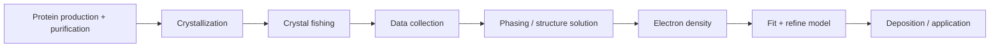
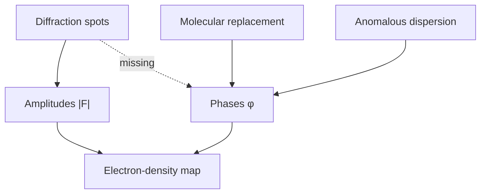

---
title: Lecture 4 — Protein Crystallography Data Processing and Folding Prediction
type: lecture
tags: [protein-crystallography, phase-problem, alphafold]
lectures: [L04]
updated: 2026-10-19
status: draft
---

# Lecture 4 — Protein Crystallography Data Processing and Folding Prediction

> Source: `raw/biohybrid_nanostructures_4_5_6.pdf`, pp. 1–5.

## In one paragraph
Lecture 4 completes [[protein-crystallography]] by moving from diffraction intensities to a structural model. The measured reflection intensity gives $|F_h|^2$, but the phase $\phi_h$ is lost, creating the [[phase-problem]] [L4, p.1]. The workflow is protein production, crystallisation, crystal fishing, data collection, structure solution, model fitting, refinement, deposition and application [L4, p.4]. Data processing includes indexing, integration, scaling, merging, $R_{\mathrm{merge}}$, [[ramachandran-plot]] validation and resolution reporting [L4, pp.1–3]. The last pages connect crystallography to the [[protein-folding-problem]], [[alphafold]] and [[protein-mpnn]] [L4, pp.4–5].

## Key concepts
- [[structure-factor]] — complex reflection amplitude whose magnitude is inferred from intensity [L4, p.1].
- [[phase-problem]] — phases are essential but not measured directly [L4, p.1].
- [[crystallographic-data-processing]] — indexing, integration, scaling, merging and validation [L4, pp.1–2].
- [[ramachandran-plot]] — backbone $\phi/\psi$ validation [L4, p.2].
- [[molecular-replacement]], [[direct-methods]] and [[anomalous-dispersion]] — phasing routes [L4, p.1].
- [[protein-folding-problem]], [[alphafold]] and [[protein-mpnn]] — structure prediction and inverse design [L4, pp.4–5].

## The chemistry / physics
$$F_h=|F_h|\exp(i\phi_h), \qquad I_h\propto |F_h|^2$$

| Symbol | Meaning | Units / notes |
|---|---|---|
| $F_h$ | structure factor of reflection $h$ | electron-density Fourier coefficient |
| $|F_h|$ | amplitude obtained from intensity | arbitrary diffraction units |
| $\phi_h$ | phase angle | rad or degrees |
| $I_h$ | measured reflection intensity | detector counts |

Assumptions: ordered crystal, kinematic diffraction and adequate completeness. Limits include crystal disorder, radiation damage, missing phases and model bias [L4, pp.1–2].

## Diagrams

*Takeaway: lecture 4 frames crystallography as a data-reduction and validation pipeline [L4, p.4].*

*Takeaway: amplitudes alone are insufficient; phasing supplies the missing information [L4, p.1].*

## Worked numbers / orders of magnitude
- Smaller resolution numbers are better; the notes compare sub-Å resolution to the 1.54 Å C–C bond scale [L4, p.2].
- Expected $R_{\mathrm{merge}}$ values are written as below 10% and below 30%, but the exact context needs rechecking [L4, p.2].
- Ramachandran angles span roughly $-180^\circ$ to $+180^\circ$ [L4, p.2].

## Connections
Builds on [[L03]], [[x-ray-diffraction]], [[reciprocal-space-fourier-transform]] and [[protein-crystals]]. It prepares the transition to nanoparticle design in [[L05]] by emphasising validation before use.

## Uncertain or illegible
- [L4, p.2] $R_{\mathrm{merge}}$ thresholds “<10%” and “<30%” are context-ambiguous.
- [L4, p.3] database-validation note is legible in meaning but not in named database.

