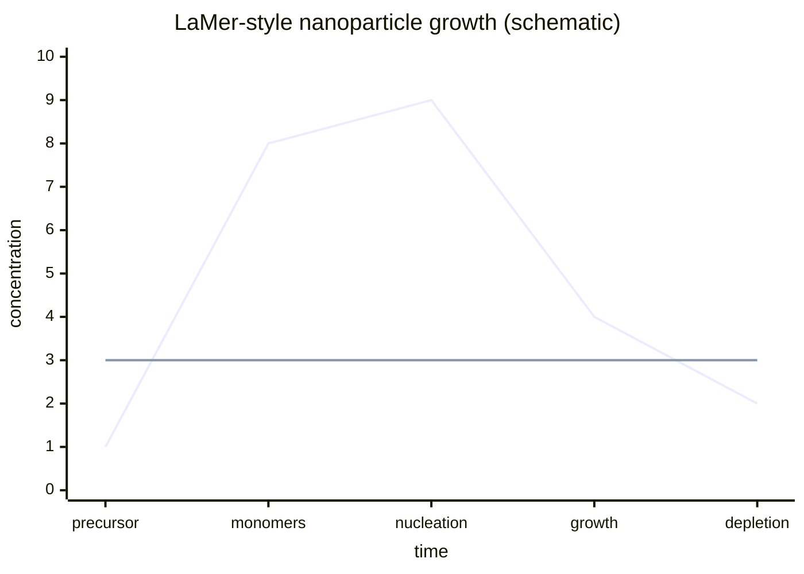
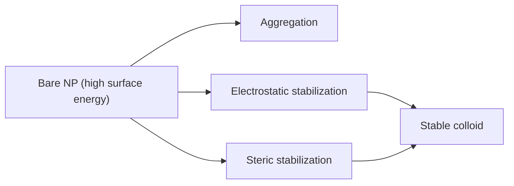

---
title: Lecture 5 — Nanoparticle Growth, Stabilisation and Ligands
type: lecture
tags: [nanoparticles, nucleation, gold, ligands]
lectures: [L05]
updated: 2026-10-19
status: draft
---

# Lecture 5 — Nanoparticle Growth, Stabilisation and Ligands

> Source: `raw/biohybrid_nanostructures_4_5_6.pdf`, pp. 6–15.

## In one paragraph
Lecture 5 introduces [[nanoparticles]] as bottom-up products between bulk matter and individual molecules, with fluorescence, magnetism, plasmonics and catalysis [L5, p.6]. Growth follows monomer generation, supersaturation, nucleation and growth captured by [[classical-nucleation-theory]], then evolves through [[coalescence-ostwald-ripening]] [L5, pp.6–8]. Because particles aggregate to reduce surface energy, [[nanoparticle-stabilization]] uses [[electrical-double-layer]] repulsion or [[steric-stabilization]] [L5, pp.8–10]. The lecture then covers [[gold-nanoparticles]], [[turkevich-method]], [[seed-mediated-growth]], [[nanoparticle-ligands]], [[ligand-exchange]], [[nanoparticle-synthesis-in-nanoreactors]], [[hot-injection]] and [[quantum-dots]] [L5, pp.11–15].

## Key concepts
- [[nanoparticles]] and [[nanoparticle-growth]] — clusters grown bottom-up from atoms/monomers [L5, p.6].
- [[classical-nucleation-theory]] — surface penalty versus bulk free-energy gain [L5, p.7].
- [[coalescence-ostwald-ripening]] — merging or monomer transfer to reduce surface energy [L5, p.8].
- [[electrical-double-layer]] and [[steric-stabilization]] — colloidal stability mechanisms [L5, pp.9–10].
- [[gold-nanoparticles]], [[turkevich-method]] and [[seed-mediated-growth]] — citrate and CTAB routes [L5, pp.11–13].
- [[nanoparticle-ligands]] and [[ligand-exchange]] — surface control of solubility/function [L5, pp.13–15].

## The chemistry / physics
Lecture-level metal reduction is summarised as:

$$\mathrm{M^{+}+e^{-}\xrightarrow{reducing\ agent}M_n}$$

| Symbol | Meaning | Units / notes |
|---|---|---|
| $\mathrm{M^+}$ | dissolved metal precursor ion | mol L$^{-1}$ |
| $e^-$ | reducing equivalent | charge |
| $\mathrm{M_n}$ | metallic nanoparticle with $n$ atoms | nm-scale particle |

For nucleation:

$$\Delta G(r)=4\pi r^2\gamma+\frac{4}{3}\pi r^3\Delta G_v$$

| Symbol | Meaning | Units / notes |
|---|---|---|
| $\gamma$ | surface energy | J m$^{-2}$ |
| $\Delta G_v$ | bulk free-energy change per volume | J m$^{-3}$ |
| $r_c$ | critical cluster radius | m, commonly nm |

Assumptions: spherical, homogeneous nuclei and uniform surface energy; useful qualitatively for the critical size [L5, p.7].

## Diagrams

*Takeaway: nucleation occurs after supersaturation, then monomer depletion limits growth [L5, p.6].*

*Takeaway: surface chemistry prevents aggregation [L5, pp.8–10].*

## Worked numbers / orders of magnitude
- Seed-mediated Au growth lists seeds around 3–5 nm [L5, p.13].
- Citrate and CTAB are key Au ligands/reagents; CTAB is connected to photothermal treatment [L5, p.13].
- Ligand shells are drawn as nanometre-scale regions around nanoparticle cores [L5, p.14].

## Connections
Builds on [[biohybrid-materials]] from [[L01]] by supplying the inorganic nanoparticle component. [[L06]] measures the resulting colloids.

## Uncertain or illegible
- [L5, p.12] the NaBH$_4$/ascorbic-acid reducing-agent note is partly compressed.
- [L5, p.15] the final nanoparticle-stabilisation line is partly cut off.

