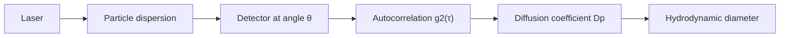
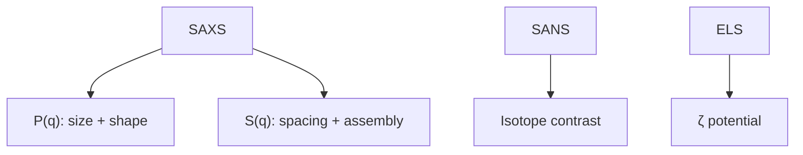

---
title: Lecture 6 — Scattering, DLS, Zeta Potential, SAXS and SANS
type: lecture
tags: [scattering, dls, saxs, zeta-potential, sans]
lectures: [L06]
updated: 2026-10-19
status: draft
---

# Lecture 6 — Scattering, DLS, Zeta Potential, SAXS and SANS

> Source: `raw/biohybrid_nanostructures_4_5_6.pdf`, pp. 16–26.

## In one paragraph
Lecture 6 characterises the colloids introduced in [[L05]]. It surveys [[scattering-methods]]: SAXS for isolated particles/assemblies, SANS for solution contrast and DLS for particles in solution and surface charge [L6, p.16]. [[dynamic-light-scattering]] monitors Brownian-motion-driven intensity fluctuations and extracts diffusion, hydrodynamic diameter and [[polydispersity-index]] through the [[stokes-einstein-equation]] and autocorrelation functions [L6, pp.17–20]. [[zeta-potential]] and [[electrophoretic-light-scattering]] report colloidal stability via the slipping plane [L6, p.21]. [[small-angle-x-ray-scattering]], [[guinier-analysis]], [[saxs-form-structure-factor]], [[small-angle-x-ray-diffraction]], [[neutron-scattering]] and [[sans-contrast-variation]] extend the toolbox from size distributions to structure and contrast labelling [L6, pp.22–26].

## Key concepts
- [[dynamic-light-scattering]] — time-dependent scattered intensity from Brownian motion [L6, pp.18–20].
- [[stokes-einstein-equation]] — converts diffusion coefficient to hydrodynamic diameter [L6, p.17].
- [[polydispersity-index]] — size-distribution breadth and data-quality metric [L6, p.17].
- [[zeta-potential]] and [[electrophoretic-light-scattering]] — mobility and colloid stability [L6, p.21].
- [[small-angle-x-ray-scattering]], [[guinier-analysis]] and [[saxs-form-structure-factor]] — size, shape, concentration and assembly [L6, pp.22–25].
- [[small-angle-x-ray-diffraction]], [[neutron-scattering]] and [[sans-contrast-variation]] — ordered lattices and isotope contrast [L6, pp.25–26].

## The chemistry / physics
$$D_p=\frac{k_BT}{3\pi\eta x_{h,t}}$$

| Symbol | Meaning | Units / notes |
|---|---|---|
| $D_p$ | particle diffusion coefficient | m$^2$ s$^{-1}$ |
| $k_B$ | Boltzmann constant | J K$^{-1}$ |
| $T$ | absolute temperature | K |
| $\eta$ | dynamic viscosity | Pa s |
| $x_{h,t}$ | translational hydrodynamic diameter | m |

For scattering:

$$q=\frac{4\pi n}{\lambda_0}\sin\left(\frac{\theta}{2}\right), \qquad I(q)\propto P(q)S(q)$$

| Symbol | Meaning | Units / notes |
|---|---|---|
| $q$ | scattering vector magnitude | nm$^{-1}$ |
| $n$ | refractive index | dimensionless |
| $\lambda_0$ | wavelength in vacuum | nm |
| $P(q)$ | form factor | size/shape |
| $S(q)$ | structure factor | interparticle arrangement |

Assumptions: dilute, single-scattering, Brownian particles for DLS; SAXS/SANS fits can be ambiguous for polydisperse samples [L6, pp.17,19,24].

## Diagrams

*Takeaway: DLS extracts size from correlation-decay time [L6, pp.18–20].*

*Takeaway: scattering outputs depend on contrast and dynamics [L6, pp.21–26].*

## Worked numbers / orders of magnitude
- Good DLS data: exponential decay, high repeatability and amplitude above roughly 0.8; poor data can arise from wrong concentration, dust, bubbles, sedimentation or aggregation [L6, pp.17,19].
- Stable colloids are indicated by $\zeta<-30$ mV or $\zeta>+30$ mV; $\zeta\approx0$ mV near the isoelectric point lowers stability [L6, p.21].
- SAXS spacing estimate: $d\approx2\pi/q_{max}$, with an example near 4.5 nm for spheres [L6, p.25].

## Connections
Uses [[electrical-double-layer]] and [[nanoparticle-stabilization]] from [[L05]], and reconnects to [[x-ray-diffraction]] and [[structure-factor]] from [[L03]]/[[L04]].

## Uncertain or illegible
- [L6, p.24] DNA-ligand drawing is clear in concept but not in sequence/chemistry.
- [L6, p.26] final SAXS/SANS comparison is cut off after “while …”.

