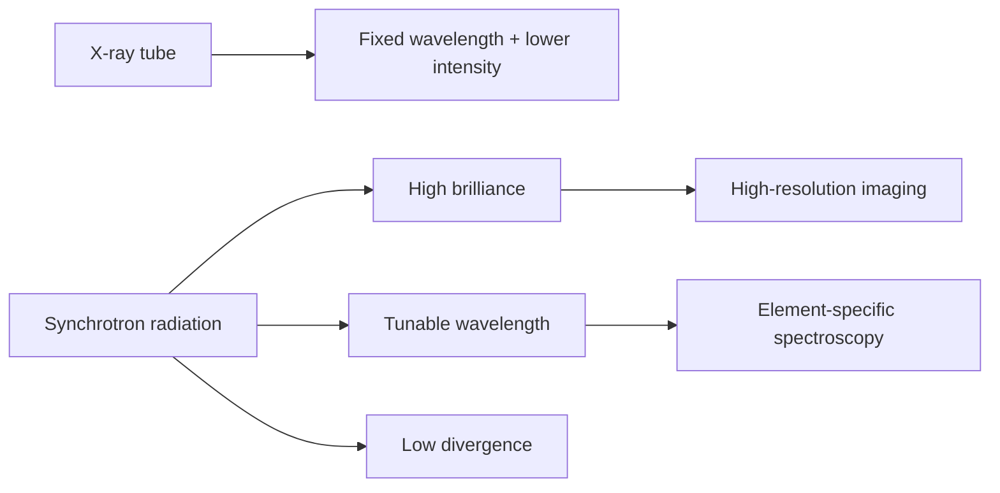
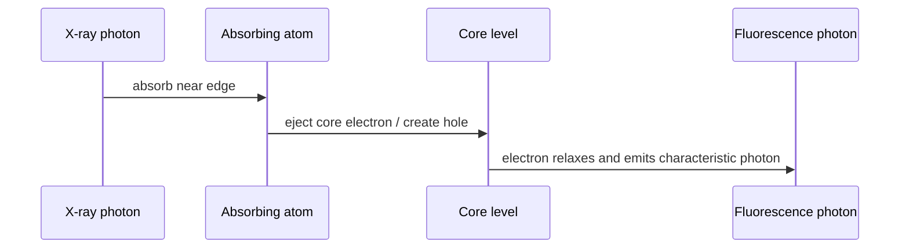

# Lecture 7 — Synchrotron X-rays, X-ray Imaging and Biomaterials

> Source: `raw/biohybrid_nanostructures_7_8_9_10.pdf`, pp. 1–6.

## In one paragraph
Lecture 7 extends earlier [[x-ray-diffraction]] into X-ray imaging and spectroscopy for biohybrid materials. X-rays are useful because their short wavelength gives high spatial resolution, their penetration depth exceeds electrons and visible light, and their element-specific interactions allow 3D structure, elemental mapping and non-destructive imaging of biological samples in near-physiological conditions [L7, p.1]. The lecture contrasts laboratory X-ray tubes with [[synchrotron-radiation]], then introduces [[x-ray-absorption-near-edge-structure]], [[x-ray-fluorescence-spectroscopy]], [[x-ray-free-electron-laser]], [[serial-femtosecond-crystallography]] and [[coherent-x-ray-imaging]] [L7, pp.1–6]. It also motivates [[nanoparticle-drug-delivery]] and natural [[biominerals]] such as bone as hierarchical [[biohybrid-materials]] [L7, pp.3–4].

## Key concepts
- [[synchrotron-radiation]] — intense, brilliant, tunable X-rays from relativistic electrons in bending magnets, wigglers and undulators [L7, p.1].
- [[x-ray-absorption-near-edge-structure]] — near-edge absorption fine structure reports oxidation state and local electronic/structural environment [L7, p.2].
- [[x-ray-fluorescence-spectroscopy]] — element-specific fluorescence maps elemental distributions in samples [L7, p.2].
- [[nanoparticle-drug-delivery]] — nanocarriers can combine therapy, diagnostics, targeting and controlled release but need ADME/toxicity monitoring [L7, p.3].
- [[biominerals]] and [[biomineralization]] — natural composites such as bone combine soft organic matrices with hard inorganic minerals [L7, p.4].
- [[x-ray-free-electron-laser]], [[serial-femtosecond-crystallography]] and [[coherent-x-ray-imaging]] — ultrabright pulsed X-rays for time-resolved and high-resolution studies [L7, p.5].

## The chemistry / physics
For X-ray methods, wavelength controls the smallest real-space distances that can be probed:

$$d \approx \frac{\lambda}{2\sin\theta}$$

| Symbol | Meaning | Units / notes |
|---|---|---|
| $d$ | resolvable spacing or Bragg-plane spacing | m, usually Å or nm |
| $\lambda$ | X-ray wavelength | m, typically about 0.01–10 nm |
| $\theta$ | scattering angle | rad or degrees |

Assumptions: this is the diffraction-style resolution relation from [[bragg-law]]; imaging resolution also depends on optics, detector, dose and reconstruction. The lecture-level point is qualitative: shorter $\lambda$ supports higher resolution [L7, p.1].

Synchrotron radiation occurs when a relativistic electron is accelerated transversely:

$$P \propto \frac{e^2 c}{\rho^2}\gamma^4$$

| Symbol | Meaning | Units / notes |
|---|---|---|
| $P$ | radiated power | W |
| $e$ | elementary charge | C |
| $c$ | speed of light | m s$^{-1}$ |
| $\rho$ | bending radius of the storage-ring path | m |
| $\gamma$ | Lorentz factor of the electron | dimensionless |

This scaling is included as outside-the-lecture context for the “near light speed + bending magnets” statement. It assumes relativistic circular acceleration and explains why synchrotrons are high-brilliance sources [L7, p.1].

## Diagrams

*Takeaway: synchrotrons trade facility complexity for brighter, tunable, better collimated X-rays [L7, p.1].*

*Takeaway: XANES reads the absorption edge, while XRF reads the emitted element-specific fluorescence [L7, p.2].*

## Worked numbers / orders of magnitude
- X-rays are described as shorter wavelength than visible light and therefore suitable for nanoscale and molecular structure [L7, p.1].
- [[coherent-x-ray-imaging]] is noted with resolution down to about 3 nm for single-particle imaging [L7, p.5].
- Natural biomaterials combine soft organic biomolecules with hard inorganic phases such as calcium phosphate or calcium carbonate [L7, p.4].

## Connections
Builds on [[x-ray-diffraction]], [[bragg-law]], [[protein-crystallography]] and [[scattering-methods]]. It prepares [[L08]], where electrons rather than X-rays form images, and [[L09]], where biomineralization explains how organisms build hybrid mineral/organic structures.

## Uncertain or illegible
- [L7, p.4] the small note comparing SAXS/WAXS or tensor tomography near “diff. betw.” is compressed; only the general tomography message is recorded.

