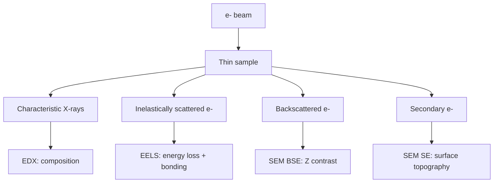
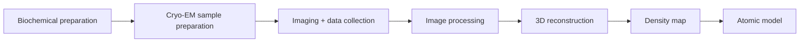

# Lecture 8 — Electron Microscopy and Electron Spectroscopies

> Source: `raw/biohybrid_nanostructures_7_8_9_10.pdf`, pp. 7–10.

## In one paragraph
Lecture 8 moves from X-rays to [[electron-microscopy]], where electron scattering produces high-resolution images but demands vacuum, stable samples and careful dose control [L8, pp.7–10]. [[energy-dispersive-x-ray-spectroscopy]] detects characteristic X-rays after inner-shell ionisation, while [[electron-energy-loss-spectroscopy]] analyses energy lost by transmitted electrons; together they provide elemental composition and electronic/chemical information [L8, p.7]. Biological samples often lack heavy atoms, so negative staining adds dense contrast but can perturb structure [L8, p.8]. [[cryo-em]] avoids dehydration/staining by imaging frozen hydrated samples and reconstructing 3D structures from many low-dose projections [L8, p.9]. [[transmission-electron-microscopy]] and [[scanning-electron-microscopy]] supply complementary internal and surface information [L8, pp.10–11].

## Key concepts
- [[energy-dispersive-x-ray-spectroscopy]] — characteristic X-rays from inner-shell relaxation, mainly for elemental composition [L8, p.7].
- [[electron-energy-loss-spectroscopy]] — energy filtering of electrons after inelastic scattering, useful for electronic structure and lighter elements [L8, p.7].
- [[cryo-em]] — vitrified hydrated sample preparation, imaging, particle picking, alignment, reconstruction and model building [L8, p.9].
- [[transmission-electron-microscopy]] — transmitted electrons through thin samples give atomic to nanometre-scale structure [L8, p.10].
- [[scanning-electron-microscopy]] — a narrow electron beam scans a surface; secondary electrons give topography and backscattered electrons give compositional contrast [L8, p.11].

## The chemistry / physics
Electron de Broglie wavelength explains why electron microscopy can exceed optical resolution:

$$\lambda=\frac{h}{\sqrt{2m_e eV}}$$

| Symbol | Meaning | Units / notes |
|---|---|---|
| $\lambda$ | electron wavelength | m |
| $h$ | Planck constant | J s |
| $m_e$ | electron mass | kg |
| $e$ | elementary charge | C |
| $V$ | accelerating voltage | V |

Assumptions: non-relativistic approximation; high-voltage TEM needs relativistic corrections. The lecture states that electron radiation is a high-resolution, surface-sensitive particle probe with limited penetration compared with X-rays [L8, p.7].

The two electron-spectroscopy signals differ by what is measured:

$$E_{\mathrm{XRF}}=E_{\mathrm{outer}}-E_{\mathrm{inner}}, \qquad \Delta E=E_0-E_{\mathrm{transmitted}}$$

| Symbol | Meaning | Units / notes |
|---|---|---|
| $E_{\mathrm{XRF}}$ | characteristic X-ray energy in EDX | eV or keV |
| $E_{\mathrm{outer}}$, $E_{\mathrm{inner}}$ | atomic electron energy levels | eV |
| $\Delta E$ | electron energy loss in EELS | eV |
| $E_0$ | incident electron energy | eV or keV |
| $E_{\mathrm{transmitted}}$ | transmitted electron energy after inelastic interaction | eV or keV |

Validity: EDX is stronger for heavier elements and composition mapping; EELS can detect lighter elements and bonding/electronic states but needs thin samples [L8, p.7].

## Diagrams

*Takeaway: the same electron beam can generate imaging, elemental and chemical-structure signals [L8, pp.7–11].*

*Takeaway: cryo-EM converts many noisy low-dose particle images into a reconstructed 3D density [L8, p.9].*

## Worked numbers / orders of magnitude
- SEM is noted as probing the surface with an electron beam diameter of about 1–10 nm [L8, p.11].
- TEM requires thin samples and can reach extremely high, near-atomic resolution in favourable specimens [L8, p.10].
- Biological material lacks many heavy atoms, so contrast is weak unless staining or cryogenic low-dose workflows are used [L8, pp.8–9].

## Connections
Builds on [[L07]] by comparing X-ray penetration and element-specific signals with electron scattering. It also extends [[cryo-em]] from the earlier crystallography-method comparison.

## Uncertain or illegible
- [L8, p.8] the negative stain example appears to be uranium/uranyl stain, but the exact chemical name is not fully legible.

