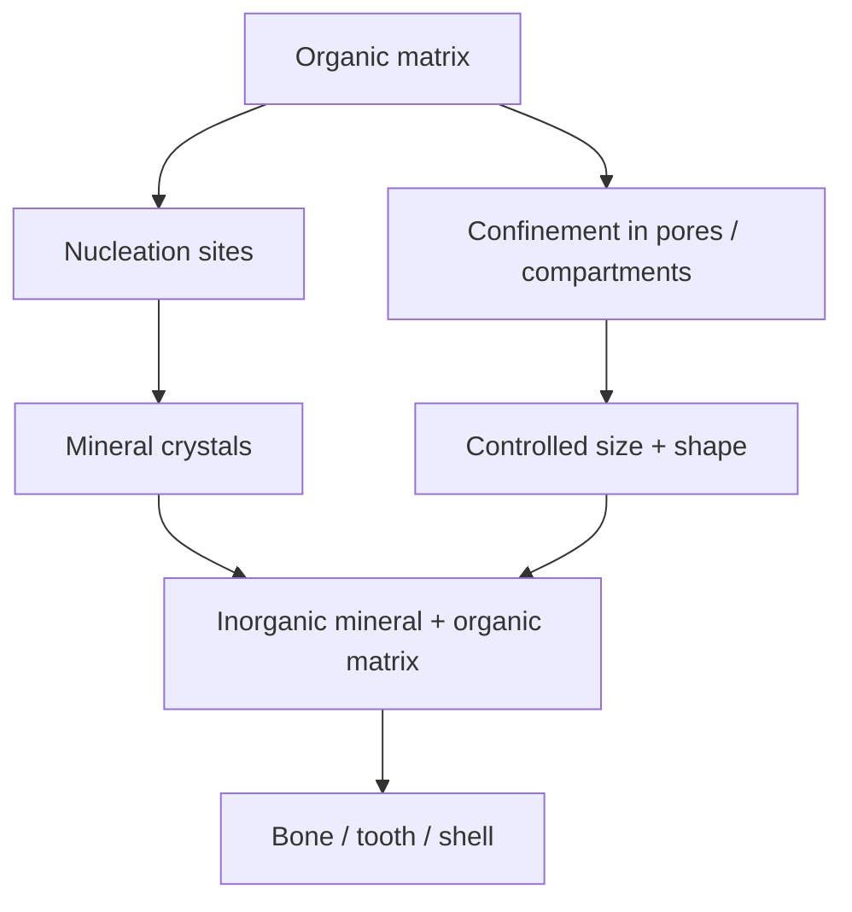
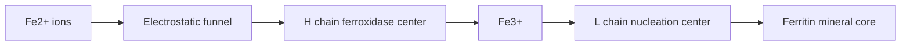

# Lecture 9 — Biomineralization and Protein Nanoreactors

> Source: `raw/biohybrid_nanostructures_7_8_9_10.pdf`, pp. 11–15.

## In one paragraph
Lecture 9 explains [[biomineralization]] as the biological production of minerals that harden or stiffen tissues, with examples including bone, teeth and shells [L9, p.12]. Organisms control mineral products by regulating nucleation, growth, confinement, organic/inorganic composites and hierarchical assembly from single biocomponents to large aggregates [L9, p.13]. [[protein-cages]] then become pre-organized, size-constrained compartments for nanoparticle formation, especially [[ferritin]] and [[apoferritin]] [L9, pp.14–15]. Ferritin stores iron by using electrostatic funnels, heavy-chain ferroxidase activity and light-chain nucleation/storage sites; apoferritin can act as a biocompatible nanoreactor for iron oxide, silver, PbS and quantum-dot-like nanomaterials [L9, pp.14–15].

## Key concepts
- [[biomineralization]] — formation of minerals by living organisms to harden or stiffen existing tissue [L9, p.12].
- [[biominerals]] — hierarchical composites such as bone, shells and pearls with organic matrix plus inorganic mineral [L9, pp.12–13].
- [[controlled-nucleation-growth]] — organisms tune nucleation rate, growth rate, supersaturation, diffusion and kinetic control [L9, pp.12–13].
- [[protein-cages]] — symmetric hollow protein containers with interior, interface and exterior surfaces [L9, p.14].
- [[ferritin]] and [[apoferritin]] — natural iron-storage cage and empty nanoreactor shell [L9, pp.14–15].
- [[nanoparticle-synthesis-in-nanoreactors]] — confined synthesis that limits size and enables defined biohybrid composites [L9, p.15].

## The chemistry / physics
The notes give Arrhenius-like nucleation and growth expressions:

$$J_N(T,\Delta G)=J_0\exp\!\left(-\frac{C\,\Delta G^\*}{k_BT}\right)$$

$$J_W(S)=kS^x$$

| Symbol | Meaning | Units / notes |
|---|---|---|
| $J_N$ | nucleation rate | nuclei m$^{-3}$ s$^{-1}$ or similar |
| $T$ | temperature | K |
| $\Delta G^\*$ | nucleation barrier | J |
| $C$ | proportionality factor from the handwritten notes | dimensionless or model-dependent; exact meaning not specified |
| $k_B$ | Boltzmann constant | J K$^{-1}$ |
| $J_0$ | pre-exponential factor | same units as $J_N$ |
| $J_W$ | growth rate from the notes | length time$^{-1}$ or amount time$^{-1}$ depending on experiment |
| $S$ | supersaturation | dimensionless |
| $k$ | growth-rate constant | units depend on $x$ |
| $x$ | empirical growth exponent | dimensionless |

Assumptions and limits: these equations summarise lecture-level dependencies, not a full crystallization model. Diffusion control means transport to the crystal surface is rate-determining; kinetic control means activated surface incorporation limits growth [L9, p.12].

Ferritin iron oxidation is summarised as:

$$4\mathrm{Fe^{2+}}+\mathrm{O_2}+6\mathrm{H_2O}\rightarrow4\mathrm{FeOOH}+8\mathrm{H^+}$$

| Symbol | Meaning | Units / notes |
|---|---|---|
| $\mathrm{Fe^{2+}}$ | ferrous iron entering ferritin | mol L$^{-1}$ |
| $\mathrm{O_2}$ | oxidant used at ferroxidase centres | mol L$^{-1}$ |
| $\mathrm{FeOOH}$ | ferric oxyhydroxide mineral-like storage product | solid phase |
| $\mathrm{H^+}$ | protons released | mol L$^{-1}$ |

This balanced reaction is outside-the-lecture stoichiometric context for the lecture statement that the H chain catalyses rapid oxidation of Fe$^{2+}$ to Fe$^{3+}$, reducing toxicity and preparing iron for storage [L9, p.14].

## Diagrams

*Takeaway: biomineralization controls where minerals nucleate, how they grow and how they are embedded [L9, pp.12–13].*

*Takeaway: ferritin separates ion entry, oxidation and mineral storage across functional cage regions [L9, p.14].*

## Worked numbers / orders of magnitude
- Protein containers are hollow, highly symmetric, roughly spherical assemblies made from modular building blocks [L9, p.14].
- Nanoreactors constrain nanoparticle size by the cavity, use mild conditions and leave a defined biological shell around the inorganic product [L9, p.15].
- The lecture lists iron oxide in ferritin for cancer-related work and non-iron examples such as silver, PbS and quantum dots [L9, p.15].

## Connections
Builds on [[nanoparticle-growth]], [[classical-nucleation-theory]], [[protein-cages]] and [[nanoparticle-synthesis-in-nanoreactors]]. [[L10]] broadens the idea from isolated cages to whole cells and microbial templates.

## Uncertain or illegible
- [L9, p.12] the constant in the nucleation-rate formula is transcribed as $C$; the handwritten definition is not provided.
- [L9, p.15] the bottom note about pore/cavity size distribution and whether too-wide ranges produce mature particles is partly illegible.

