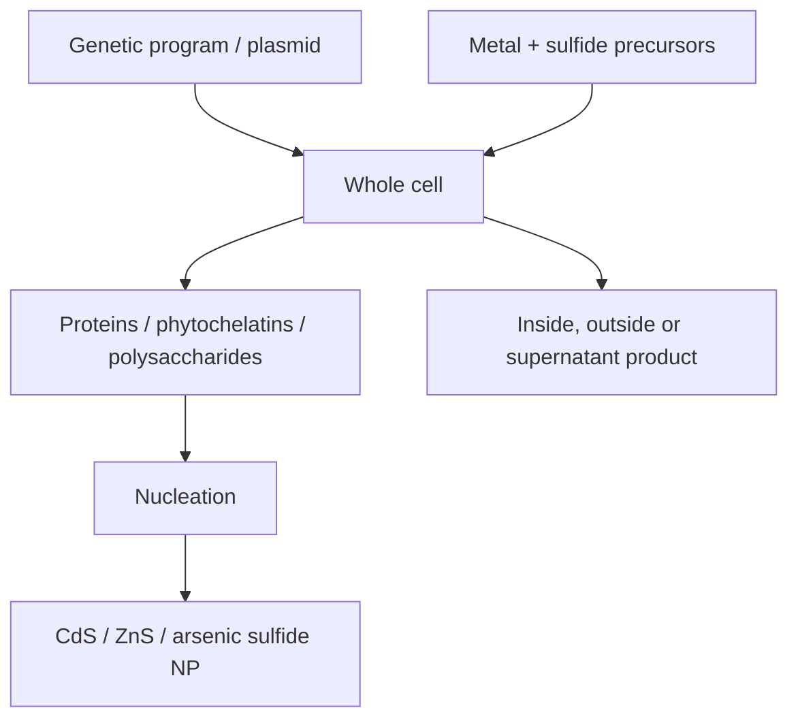

# Lecture 10 — Whole-Cell Nanomaterial Synthesis and Plasmonic Supercrystals

> Source: `raw/biohybrid_nanostructures_7_8_9_10.pdf`, pp. 16–22.

## In one paragraph
Lecture 10 scales biohybrid nanoparticle synthesis from purified protein cages to living cells, asking how nanomaterials can be synthesized inside cells and cell cultures [L10, p.16]. Compared with conventional chemical routes, [[microbial-nanomaterial-synthesis]] can use mild, water-compatible, genetically tunable and biocompatible conditions, but cell complexity makes mechanisms, impurities and reproducibility difficult [L10, pp.16–20]. Examples include CdS nanocrystals in yeast and engineered E. coli, recombinant E. coli photofactories, [[shewanella-oneidensis]] for metal reduction and arsenic sulfide minerals, halophilic bacteria, [[m13-bacteriophage]] phage display, and [[curli-fibers]] for hierarchical patterning [L10, pp.17–20]. The lecture ends with [[plasmonic-supercrystals]], where nanoparticle superlattices generate plasmonic coupling and hot spots useful for [[sers-biosensing]] [L10, pp.21–22].

## Key concepts
- [[microbial-nanomaterial-synthesis]] — biologically assisted NP formation inside or around whole cells [L10, pp.16–20].
- [[quantum-dots]] — semiconductor nanocrystals such as CdS, ZnS and CdTe appear as microbial products or phage-templated wires [L10, pp.17–20].
- [[shewanella-oneidensis]] — anaerobic bacterium used for dissimilatory metal reduction and extracellular mineral formation [L10, pp.18–19].
- [[m13-bacteriophage]] and [[phage-display]] — peptide display supplies mineral-binding templates and libraries [L10, p.19].
- [[curli-fibers]] — engineered E. coli amyloid fibres that assemble inorganic nanomaterials into ordered structures [L10, p.20].
- [[plasmonic-supercrystals]] and [[sers-biosensing]] — ordered Au nanoparticle arrays create coupled plasmons, hot spots and enhanced Raman detection [L10, pp.21–22].

## The chemistry / physics
Example semiconductor precipitation from the lecture:

$$\mathrm{Cd^{2+}+S^{2-}\rightarrow CdS(s)}$$

| Symbol | Meaning | Units / notes |
|---|---|---|
| $\mathrm{Cd^{2+}}$ | cadmium ion precursor | mol L$^{-1}$ |
| $\mathrm{S^{2-}}$ | sulfide ion precursor, produced chemically or biologically | mol L$^{-1}$ |
| $\mathrm{CdS(s)}$ | cadmium sulfide semiconductor nanocrystal | solid |

Assumptions: precipitation is written as net chemistry; in cells, ligands, phytochelatins, proteins, pH, transport and compartmentalization alter nucleation and growth [L10, pp.17–18].

Shewanella arsenic sulfide synthesis is described by microbial redox conversion:

$$\mathrm{As(V)\rightarrow As(III)}, \qquad \mathrm{S_2O_3^{2-}\rightarrow S^{2-}}$$

| Symbol | Meaning | Units / notes |
|---|---|---|
| $\mathrm{As(V)}$ | arsenate oxidation state | dissolved species |
| $\mathrm{As(III)}$ | reduced arsenic state | dissolved/solid precursor species |
| $\mathrm{S_2O_3^{2-}}$ | thiosulfate | mol L$^{-1}$ |
| $\mathrm{S^{2-}}$ | sulfide | mol L$^{-1}$ |

Validity: the scan gives the redox directions, not a balanced pathway or enzyme list beyond Shewanella-style dissimilatory metal reduction [L10, p.19].

For SERS, electromagnetic enhancement is dominated by local field amplification:

$$G_{\mathrm{SERS}}\approx\left|\frac{E_{\mathrm{loc}}}{E_0}\right|^4$$

| Symbol | Meaning | Units / notes |
|---|---|---|
| $G_{\mathrm{SERS}}$ | Raman enhancement factor | dimensionless |
| $E_{\mathrm{loc}}$ | local electric field in a plasmonic hot spot | V m$^{-1}$ |
| $E_0$ | incident electric field | V m$^{-1}$ |

This is outside-the-lecture context for the note that localised surface plasmons can enhance Raman signals up to about $10^{10}$ and detect biomolecules at single-molecule levels [L10, p.22].

## Diagrams

*Takeaway: cells couple precursor chemistry to biological ligands and compartments, so product location and mechanism are hard to isolate [L10, pp.17–20].*

*Takeaway: nanoparticle supercrystals amplify optical fields through collective plasmon coupling [L10, pp.21–22].*

## Worked numbers / orders of magnitude
- Chemical routes can give good size/shape control but may use energy-intensive, toxic chemicals, multi-step routes and expensive high-cost conditions [L10, p.16].
- Biogenic routes are described as mild, green, solvent-sparing and genetically tunable, but often hard to characterize optically and mechanistically [L10, pp.16–20].
- SERS hot spots are noted as enhancing signals up to $10^{10}$ [L10, p.22].

## Connections
Extends [[L09]] from protein-cage nanoreactors to living-cell reactors, and connects [[quantum-dots]], [[nanoparticles]], [[biohybrid-materials]] and [[nanoparticle-drug-delivery]] to biosensing and material patterning.

## Uncertain or illegible
- [L10, p.18] the “TMAO controls expression” line in the Shewanella gene-circuit note is legible, but the exact metal oxidation-state target beside it is compressed.
- [L10, p.21] the magnetite line is read as assembly of Fe$_3$O$_4$ and Co into magnetic structures; the exact formulation should be rechecked.

