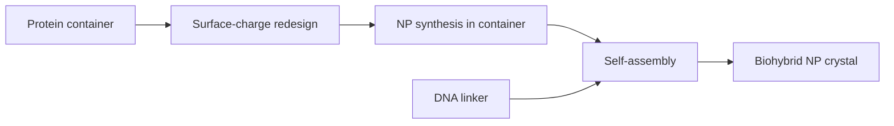
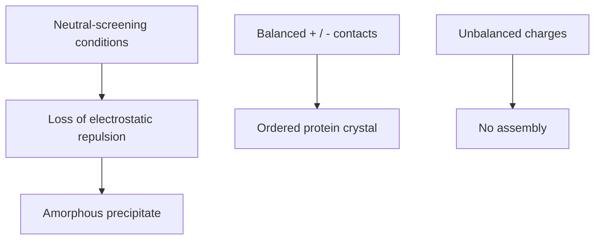
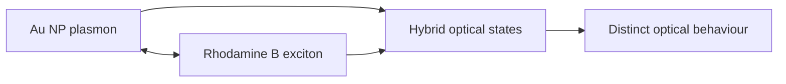

# Lecture 11 — Protein and DNA Assemblies as Conductive Biohybrids

> Source: `raw/biohybrid_nanostructures_11_12_13.pdf`, pp. 1–7.

## In one paragraph
Lecture 11 moves from biological nanoreactors to ordered conductive and optical biohybrids. The main routes are protein containers as building blocks, nanoparticle superlattices with protein linkers, DNA as a linker for nanoparticle assembly, and DNA as a linker for nanoparticle superlattices [L11, p.1]. Hydrophobic ligands stabilise nanoparticle surfaces and drive aggregation through van der Waals and hydrophobic effects, while protein crystal scaffolds and DNA linkers introduce programmability, long-range order and post-assembly stabilisation by fixation [L11, pp.1–7]. The lecture also introduces [[plasmon-exciton-coupling]] between metallic nanoparticle plasmons and semiconductor/organic excitons, and uses gold nanoparticle/Rhodamine B and single-stranded DNA examples to show how nanoscale spacing changes optical behaviour [L11, p.6].

## Key concepts
- [[biohybrid-conductive-materials]] — biohybrid assemblies where biological scaffolds organise conductive, optical, magnetic or catalytic nanoparticles [L11, pp.1–2].
- [[protein-crystal-nanoparticle-superlattices]] — redesigned ferritin/protein crystals used to position nanoparticle cargo in higher-order lattices [L11, pp.2–5].
- [[gold-nanoparticles]] and [[gold-nanorods]] — noble-metal plasmonic building blocks for coupling, superlattices and nanomedicine [L11, pp.2,6].
- [[plasmon-exciton-coupling]] — hybrid optical states formed by coupling localized plasmons to excitons [L11, p.6].
- [[dna-mediated-nanoparticle-assembly]] — DNA-programmed nanoparticle aggregates and FCC/BCC superlattices [L11, pp.6–7].
- [[rosetta-protein-design]] and [[protein-cages]] — computational surface-charge redesign of protein containers for assembly [L11, pp.2–3].

## The chemistry / physics
Surface-charge redesign of ferritin-like protein cages is represented as a residue-level electrostatic engineering problem. The scan marks Lys/Arg as positive and Asp/Glu as negative; Rosetta is used to change residue charge without destroying the protein container [L11, pp.2–3].

$$q_{\mathrm{surf}}=\sum_i z_i e$$

| Symbol | Meaning | Units / notes |
|---|---|---|
| $q_{\mathrm{surf}}$ | net designed surface charge on a protein patch | C |
| $z_i$ | integer charge state of residue or ligand group | dimensionless |
| $e$ | elementary charge | C |
| $i$ | charged surface group index | dimensionless |

Assumptions and limits: this is a bookkeeping model for sign and patterning, not a full electrostatic free energy; pH, ionic strength and local p$K_a$ values change real charge states. The lecture’s point is that changing a small number of surface residues can switch protein-crystal contacts from no assembly to ordered crystals [L11, p.3].

The optical part is coupling between a plasmon mode and an exciton:

$$E_{\pm}=\frac{E_{\mathrm{pl}}+E_{\mathrm{ex}}}{2}\pm\sqrt{g^2+\left(\frac{E_{\mathrm{pl}}-E_{\mathrm{ex}}}{2}\right)^2}$$

| Symbol | Meaning | Units / notes |
|---|---|---|
| $E_{\pm}$ | upper/lower hybrid optical mode energy | eV |
| $E_{\mathrm{pl}}$ | localized surface plasmon energy | eV |
| $E_{\mathrm{ex}}$ | exciton transition energy | eV |
| $g$ | plasmon-exciton coupling strength | eV |

Assumptions and limits: the two-oscillator expression is outside-the-lecture mathematical context for the handwritten statement that plasmon-exciton coupling integrates localized metallic surface plasmons with semiconductor-molecule excitons [L11, p.6]. It is valid as a schematic when one dominant plasmon and one dominant exciton interact.

## Diagrams

*Takeaway: L11 compares protein redesign and DNA hybridisation as two routes from nanoscale building blocks to ordered nanoparticle crystals [L11, pp.1–7].*

*Takeaway: ionic strength and charge pattern decide whether protein building blocks precipitate, crystallise or remain unassembled [L11, pp.2–3].*

*Takeaway: metallic nanoparticle plasmons can couple to molecular excitons when energy and spacing are compatible [L11, p.6].*

## Worked numbers / orders of magnitude
- The scan labels a gold nanoparticle synthesis product around 7 nm before encapsulation and water-solubilising ligands [L11, p.4].
- Crystallographic screening can use many conditions; the page notes high-throughput screening over more than 1500 conditions [L11, p.3].
- DNA linkers can direct FCC or BCC nanoparticle superlattices, depending on strand architecture and programmed connectivity [L11, p.7].
- Protein crystal structures provide long-range periodic order; fixation/stabilisation can improve chemical and temperature resistance [L11, p.5].

## Connections
Builds on [[nanoparticle-synthesis-in-nanoreactors]], [[ferritin]], [[protein-crystals]], [[gold-nanoparticles]], [[nanoparticle-ligands]], [[dna-rna]] and [[dna-mediated-nanoparticle-assembly]]. It prepares [[L12]] by shifting from bulk/crystal assemblies to surface organisation and lithographic surface patterning.

## Uncertain or illegible
- [L11, p.3] the exact protein-container name besides ferritin/Rosetta is partly compressed; recorded generically as ferritin-like protein containers.
- [L11, p.4] the catalyst note reads as cerium oxide/Ce; exact solution/crystal colour annotations should be rechecked.
- [L11, p.5] the row of possible binary-crystal stoichiometries contains several small formulae; only the general point that different charge variants produce multiple candidate combinations is recorded.

