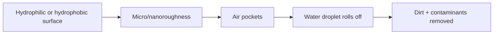
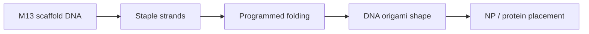
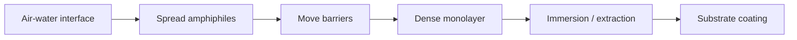

# Lecture 12 — Surface Organisation, Monolayers and Nanolithography

> Source: `raw/biohybrid_nanostructures_11_12_13.pdf`, pp. 8–17.

## In one paragraph
Lecture 12 shifts biohybrid nanostructures onto surfaces. It covers [[superhydrophobicity-lotus-effect]], [[dna-origami]] as a programmable scaffold, DNA/protein hybrids, [[self-assembled-monolayers]], DNA-linked nanoparticle attachment to surfaces, [[langmuir-blodgett-films]], [[scanning-tunneling-microscopy]] and [[electron-beam-lithography]] [L12, pp.8–17]. The recurring message is that surface chemistry, molecular packing and external patterning methods determine whether nanoscale objects lie flat, organise densely, remain addressable or can be written into device-like architectures [L12, pp.11–17].

## Key concepts
- [[superhydrophobicity-lotus-effect]] — micro/nanostructured surfaces create extreme water repellency and self-cleaning [L12, p.8].
- [[dna-origami]] — M13-derived scaffold DNA folded by staple strands into programmed 2D/3D forms [L12, pp.9–10].
- [[self-assembled-monolayers]] — spontaneous molecular films from surface-active molecules with headgroup, spacer and tail [L12, pp.11–12].
- [[langmuir-blodgett-films]] — amphiphile monolayers compressed at an air-water interface and transferred onto substrates [L12, pp.13–15].
- [[scanning-tunneling-microscopy]] — conductive-tip surface characterisation and manipulation using tunnelling current [L12, pp.15–16].
- [[electron-beam-lithography]] — electron-beam writing of nanoscale surface patterns, often into PMMA resist [L12, p.16].

## The chemistry / physics
The lotus effect depends on roughness amplifying hydrophobicity. A compact schematic relation is the Cassie-Baxter form:

$$\cos\theta^\*=f_s(\cos\theta+1)-1$$

| Symbol | Meaning | Units / notes |
|---|---|---|
| $\theta^\*$ | apparent contact angle on rough composite surface | degrees |
| $\theta$ | Young contact angle on flat material | degrees |
| $f_s$ | solid fraction touching the droplet | dimensionless, 0–1 |

Assumptions and limits: this is outside-the-lecture mathematical context for the handwritten lotus-effect mechanism. It assumes a composite solid-air contact under the droplet and does not describe liquid-filled roughness [L12, p.8].

For STM, tunnelling current decays approximately exponentially with tip-sample separation:

$$I(z)\propto V\exp(-2\kappa z),\qquad \kappa=\sqrt{\frac{2m\Phi}{\hbar^2}}$$

| Symbol | Meaning | Units / notes |
|---|---|---|
| $I$ | tunnelling current | A, often pA–nA |
| $V$ | bias voltage | V |
| $z$ | tip-sample distance | m, typically sub-nm to nm |
| $\kappa$ | decay constant | m$^{-1}$ |
| $m$ | electron mass | kg |
| $\Phi$ | effective barrier/work function | J or eV |
| $\hbar$ | reduced Planck constant | J s |

Assumptions and limits: this simple barrier picture matches the lecture’s note that STM measures tunnelling current with either constant-height or constant-current feedback, but it does not directly map individual atoms where electronic states dominate topographic contrast [L12, pp.15–16].

## Diagrams

*Takeaway: the lotus effect combines chemistry and micro/nanoscale roughness to make self-cleaning surfaces [L12, p.8].*

*Takeaway: DNA origami converts base pairing into addressable nanoscale geometry [L12, pp.9–10].*

*Takeaway: Langmuir-Blodgett deposition forms ordered monolayers by compressing amphiphiles before transfer [L12, p.15].*

## Worked numbers / orders of magnitude
- DNA origami uses a long single-stranded scaffold and many shorter staple strands; the scan names M13 bacteriophage as the scaffold source [L12, p.9].
- AFM detects tip-sample forces with $F=k\Delta z$ and uses Si/Si$_3$N$_4$ probe tips to visualise DNA origami and related surface nanostructures [L12, p.9].
- SAMs are favoured for gold by thiols/disulfides and can use alkyltrichlorosilanes on hydroxylated surfaces, alkyl sulfides on gold, alcohols/amines on gold/platinum, and carboxylic acids on Al$_2$O$_3$ [L12, pp.11–12].
- Electron-beam lithography has sub-10 nm resolution in the notes, but low throughput, high-vacuum requirements and special resist requirements such as PMMA [L12, p.16].

## Connections
Builds on [[dna-rna]], [[m13-bacteriophage]], [[gold-nanoparticles]], [[nanoparticle-ligands]], [[atomic-force-microscopy]], [[electron-microscopy]] and [[scanning-electron-microscopy]]. It prepares [[L13]] by turning nanostructure control into biomedical functions and device-like delivery systems.

## Uncertain or illegible
- [L12, p.9] the exact list of AFM tip materials is read as Si/Si$_3$N$_4$; recheck if the second material was intended differently.
- [L12, p.14] the molecular-machine section contains a meso-(R,S-R,S) isomer and helix-inversion drawings; the exact molecule name is not legible.
- [L12, p.16] the “other lithography techniques” list is partial in the scan and is recorded only as examples.

