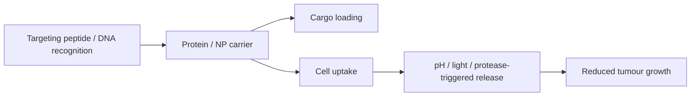
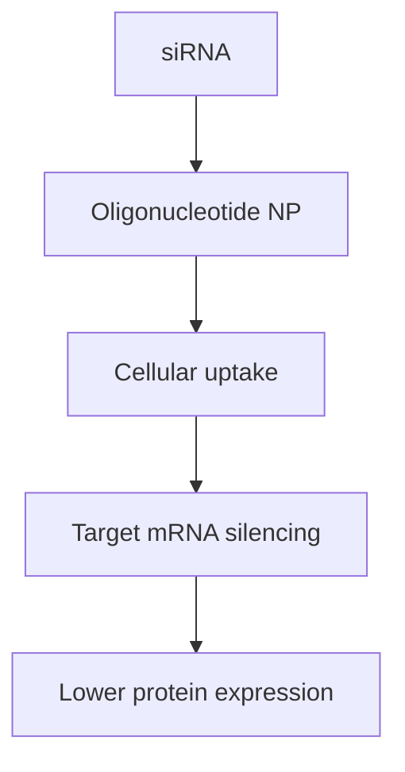

# Lecture 13 — Biomedical Applications of Biohybrid Nanostructures

> Source: `raw/biohybrid_nanostructures_11_12_13.pdf`, pp. 18–22.

## In one paragraph
Lecture 13 applies the module to nanomedicine. Nanoscale materials are similar in dimension to cells and flexible for interaction, nanoparticles offer high surface area and cargo capacity, and the lecture identifies treatment and diagnostics as theranostic targets [L13, p.18]. Protein-based systems such as [[ferritin]] can be loaded with drugs or photosensitizers, functionalised with targeting peptides, and used to reduce tumour growth rates [L13, pp.18–19]. [[gold-nanoparticles]] and [[gold-nanorods]] support photothermal therapy, pH-triggered ferritin release, and DNA nanoparticle diagnostics, while [[dna-origami]] extends the idea to enzyme/protein scaffolds, cancer recognition and siRNA delivery [L13, pp.19–22].

## Key concepts
- [[protein-based-nanomedicine]] — protein cages and protein scaffolds used as nanocarriers, targeting units and therapeutic platforms [L13, pp.18–21].
- [[nanoparticle-drug-delivery]] — nanocarriers improve loading, controlled release and targeting but face toxicity and clearance challenges [L13, pp.18–21].
- [[ferritin]] — ferritin drug delivery and photodynamic therapy via doxorubicin or photosensitizer cargo [L13, pp.18–19].
- [[gold-nanoparticles]] and [[gold-nanorods]] — size-dependent toxicity and photothermal therapy [L13, pp.19–20].
- [[dna-nanorobots]] — DNA origami systems whose recognition state exposes a reporter or therapeutic function [L13, pp.20–22].
- [[sirna-delivery]] — oligonucleotide nanoparticle delivery of siRNA for gene silencing [L13, p.22].

## The chemistry / physics
Photothermal therapy converts absorbed optical power into local heating:

$$Q=\eta I_{\mathrm{abs}}t,\qquad \Delta T=\frac{Q}{m c_p}$$

| Symbol | Meaning | Units / notes |
|---|---|---|
| $Q$ | heat deposited | J |
| $\eta$ | photothermal conversion efficiency | dimensionless |
| $I_{\mathrm{abs}}$ | absorbed optical power | W |
| $t$ | irradiation time | s |
| $\Delta T$ | temperature increase | K |
| $m$ | heated mass | kg |
| $c_p$ | heat capacity | J kg$^{-1}$ K$^{-1}$ |

Assumptions and limits: this is outside-the-lecture quantitative context for the note that ferritin with photosensitizer or CuS nanoparticles can reduce tumour growth under illumination [L13, pp.18–19]. Real tissue heating depends on heat diffusion, blood perfusion and nanoparticle distribution.

pH-triggered ferritin release is written as a state process:

$$\mathrm{Ferritin{\text -}cargo}_{\mathrm{closed}}\xrightarrow[\mathrm{acidic\ pH}]{\mathrm{endosome/lysosome}}\mathrm{cargo}_{\mathrm{released}}+\mathrm{ferritin\ fragments}$$

| Symbol | Meaning | Units / notes |
|---|---|---|
| $\mathrm{Ferritin{\text -}cargo}_{\mathrm{closed}}$ | loaded ferritin cage before release | particles or mol |
| acidic pH | lower pH in cellular compartments | pH units; scan notes pH 2.5 for release check |
| $\mathrm{cargo}_{\mathrm{released}}$ | drug/photosensitizer leaving cage | mol |

Assumptions and limits: the scan specifically notes checking ferritin release at pH 2.5 and digestion by proteases; exact intracellular pH conditions were not specified [L13, p.20].

## Diagrams

*Takeaway: L13 frames nanomedicine as a chain from carrier design to targeting, uptake, triggered release and therapy [L13, pp.18–21].*

*Takeaway: DNA nanostructures can translate molecular recognition into an optical or delivery output [L13, pp.20–22].*

*Takeaway: siRNA delivery requires a carrier that protects RNA, enters cells and releases a gene-silencing payload [L13, p.22].*

## Worked numbers / orders of magnitude
- The lecture highlights nanomaterials as nanoscale objects comparable with cell-scale biological structures and useful because of flexible interactions and high surface/cargo capacity [L13, p.18].
- Ferritin is used as a nanoscale protein container for magnetic iron oxide, doxorubicin, photosensitizers and CuS nanoparticles [L13, pp.18–19].
- Gold nanoparticle toxicity is size-dependent in the notes; exact threshold values are not given [L13, p.20].
- The lecture’s DNA nanoparticle diagnostic example targets detection of cancer cells in blood using complementary mRNA recognition and fluorescence [L13, p.20].

## Connections
Builds on [[nanoparticle-drug-delivery]], [[protein-cages]], [[ferritin]], [[gold-nanoparticles]], [[gold-nanorods]], [[dna-origami]], [[dna-mediated-nanoparticle-assembly]] and [[plasmon-exciton-coupling]]. This final lecture completes the module’s arc by converting structural control into therapy, diagnostics and material-application constraints.

## Uncertain or illegible
- [L13, p.19] the photosensitizer name appears to include zinc hexadecafluorophthalocyanine/related wording; recorded generically as a photosensitizer because the exact compound is not fully legible.
- [L13, p.20] the handwritten “what is the advantage of adding ferritin during microparticle synthesis vs adding it to already produced microparticles?” is preserved as an open question.
- [L13, p.22] the bottom note on rubisco encapsulation asks why rubisco is compartmentalised; the written answer points to substrate concentration and crystalline carbon but is incomplete.

