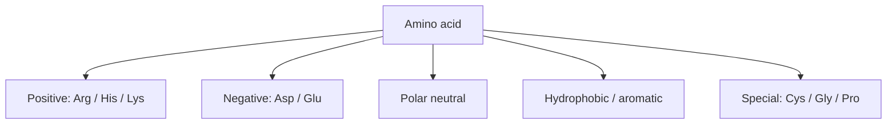

---
title: Amino Acids and Peptides
type: material
tags: [amino-acids, peptides, chirality]
lectures: [L01]
updated: 2026-10-19
status: draft
---

# Amino Acids and Peptides

Amino acids are the building blocks of proteins. The scan lists 21 proteinogenic amino acids, including charged, polar/neutral, hydrophobic/aromatic and special residues; examples include arginine/histidine/lysine, aspartic/glutamic acid, serine/threonine/asparagine/glutamine, phenylalanine/tyrosine/tryptophan, cysteine/selenocysteine/glycine/proline [L1, p.4].

$$
\mathrm{H_2N{-}CHR{-}COOH}
$$

| Symbol | Meaning | Units / notes |
|---|---|---|
| $R$ | side chain defining amino-acid identity | chemical group |
| $\mathrm{NH_2}$ | amino group | protonation depends on pH |
| $\mathrm{COOH}$ | carboxyl group | deprotonates near neutral pH |

*Takeaway: side-chain chemistry supplies charge, polarity, hydrophobicity and special structural roles.*

## D-peptides
The notes ask why D-peptides are interesting for pharmaceutical applications: stability/resistance to degradation, protease resistance, reduced immunogenicity and enhanced bioavailability/activity [L1, p.4].

## Links
Forms [[proteins]] and drives [[protein-structure]] and [[protein-folding-thermodynamics]].
