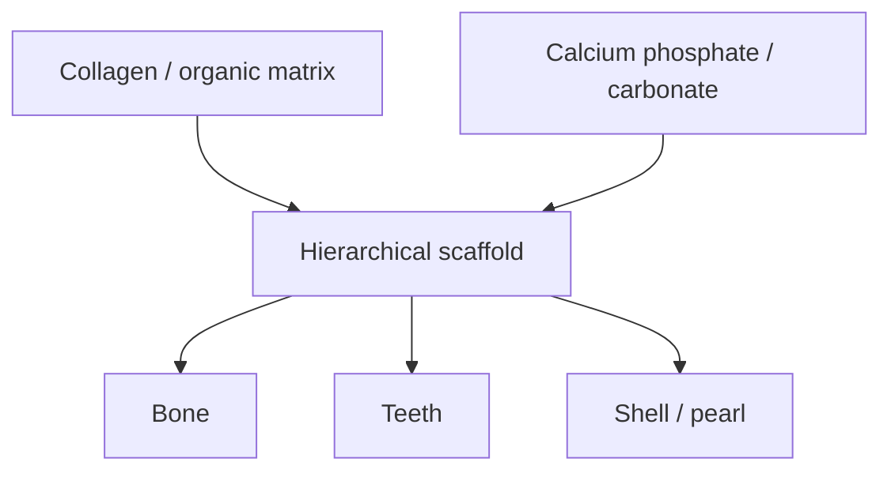

# Biominerals

Biominerals are natural biohybrid materials in which biomolecules and inorganic compounds are hierarchically organized [L7, p.4]. Biomolecules such as proteins and DNA are defined 3D, atomically precise, repairable/regenerable and soft or elastic; inorganic components such as calcium phosphate and calcium carbonate are mineralized within the organic matrix and provide hardness, stiffness and rigidity [L7, p.4].

*Takeaway: biominerals combine biological precision with inorganic mechanical strength [L7, p.4; L9, p.12].*

## Chemistry / physics
Bone-like mineralization can be represented generically as calcium phosphate precipitation:

$$10\mathrm{Ca^{2+}}+6\mathrm{PO_4^{3-}}+2\mathrm{OH^-}\rightarrow\mathrm{Ca_{10}(PO_4)_6(OH)_2(s)}$$

| Symbol | Meaning | Units / notes |
|---|---|---|
| $\mathrm{Ca^{2+}}$ | calcium ions | mol L$^{-1}$ |
| $\mathrm{PO_4^{3-}}$ | phosphate ions | mol L$^{-1}$ |
| $\mathrm{OH^-}$ | hydroxide ions | mol L$^{-1}$ |
| $\mathrm{Ca_{10}(PO_4)_6(OH)_2}$ | hydroxyapatite mineral | solid |

This balanced hydroxyapatite equation is outside-the-lecture context for the calcium-phosphate bone note. The scan itself names calcium phosphate/carbonate and bone collagen organization [L7, p.4].

## Characterisation
The lecture mentions hard X-ray computed tomography and tensor tomography for 3D reconstruction and detailed structural analysis of bone and other biomaterials [L7, p.4]. [[synchrotron-radiation]] is useful because penetration depth permits native-state imaging [L7, pp.3–4].

## Links
Formed by [[biomineralization]] and connected to [[protein-cages]] as biomolecular templates for mineral deposition.

