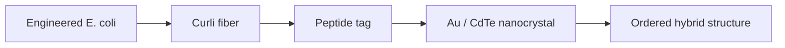

# Curli Fibers

Curli fibers are E. coli-produced extracellular fibers used in the lecture as peptide-tagged recognition scaffolds for hierarchical assembly of inorganic nanomaterials [L10, p.20]. Engineered E. coli produces curli polymers; curli-borne peptide tags recognize inorganic materials and enable assembly of Au and CdTe nanocrystals into complex ordered structures [L10, p.20].

*Takeaway: curli fibers convert bacterial self-assembly into spatial control over inorganic nanoparticles [L10, p.20].*

## Binding model
Multivalent tags increase avidity:

$$K_{\mathrm{avidity}}\gg K_{\mathrm{single}}$$

| Symbol | Meaning | Units / notes |
|---|---|---|
| $K_{\mathrm{avidity}}$ | effective binding constant for multiple tags | L mol$^{-1}$, context-dependent |
| $K_{\mathrm{single}}$ | single peptide-material binding constant | L mol$^{-1}$ |

Assumptions: qualitative relation; actual avidity depends on tag spacing, fiber density and nanoparticle size.

## Links
Part of [[microbial-nanomaterial-synthesis]] and potentially useful for [[plasmonic-supercrystals]].

