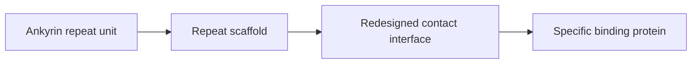

---
title: Designed Ankyrin Repeat Proteins
type: material
tags: [darpin, binding-scaffold]
lectures: [L02]
updated: 2026-10-19
status: draft
---

# Designed Ankyrin Repeat Proteins

The scan notes designed ankyrin repeat proteins as artificial protein scaffolds and highlights redesign of contact interfaces. Tetrahedral and octahedral cages are mentioned as protein-architecture examples, with trimeric proteins as building blocks [L2, p.10].

*Takeaway: repeat proteins provide modular surfaces for engineered binding.*

## Links
Part of [[rational-protein-design]] and [[protein-structure]], contrasted with antibodies and other scaffolds in [[L02]].
