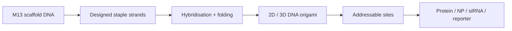

# DNA Origami

DNA origami is a technique for folding a long single-stranded DNA scaffold into prescribed nanoscale shapes using many staple strands [L12, p.9]. Lecture 12 names the M13 bacteriophage scaffold, staple-strand self-assembly and AFM visualisation; Lecture 13 uses DNA origami for protein/enzyme recognition, cancer-cell detection and siRNA delivery concepts [L12, pp.9–10; L13, pp.20–22].

*Takeaway: DNA origami turns base-pairing rules into addressable nanostructures [L12, pp.9–10].*

## Assembly physics
Base-pairing free energy drives folding:

$$\Delta G_{\mathrm{hyb}}=\Delta H_{\mathrm{hyb}}-T\Delta S_{\mathrm{hyb}}$$

| Symbol | Meaning | Units / notes |
|---|---|---|
| $\Delta G_{\mathrm{hyb}}$ | hybridisation free energy | kJ mol$^{-1}$ |
| $\Delta H_{\mathrm{hyb}}$ | enthalpy of base pairing/stacking | kJ mol$^{-1}$ |
| $T$ | temperature | K |
| $\Delta S_{\mathrm{hyb}}$ | entropy change during hybridisation | kJ mol$^{-1}$ K$^{-1}$ |

Assumptions and limits: outside-the-lecture equation. Real origami yield depends on Mg$^{2+}$, sequence design, annealing and strand stoichiometry; the scan only states scaffold plus staple-strand assembly [L12, p.9].

## Applications
Lecture 13 shows a DNA origami recognition pathway: aptamer binding, an EM grid/cryo-EM step, reconstruction of 3D volume, and localisation of a target protein [L13, p.22]. It also notes siRNA delivery, where oligonucleotide nanoparticles and blockers help cellular uptake and gene silencing [L13, p.22].

## Links
Related to [[dna-rna]], [[m13-bacteriophage]], [[dna-mediated-nanoparticle-assembly]], [[dna-nanorobots]] and [[sirna-delivery]].

