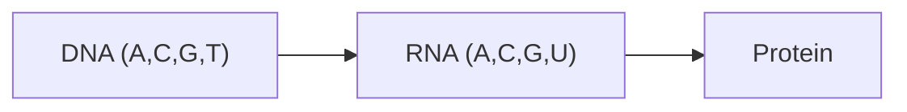

---
title: DNA and RNA
type: material
tags: [dna, rna, nucleic-acids]
lectures: [L01]
updated: 2026-10-19
status: draft
---

# DNA and RNA

DNA and RNA are nucleic-acid biomolecules in the lecture hierarchy. DNA stores genetic information; RNA is produced by transcription and mRNA codes for proteins during translation [L1, p.3]. DNA is drawn as a double helix, RNA as a copied strand, and protein as the translation product.

*Takeaway: nucleic acids connect sequence information to protein materials.*

## Chemistry / physics
The genetic code uses triplets. With four bases and three positions:

$$
4^3=64
$$

| Symbol | Meaning | Units |
|---|---|---|
| $4$ | base alphabet size | dimensionless |
| $3$ | positions per codon | dimensionless |
| $64$ | possible codons | dimensionless |

## Links
Central to [[genetic-code-central-dogma]], [[recombinant-protein-production]] and [[directed-evolution]].
