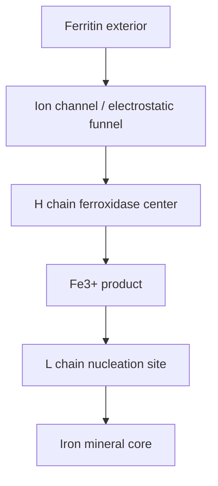
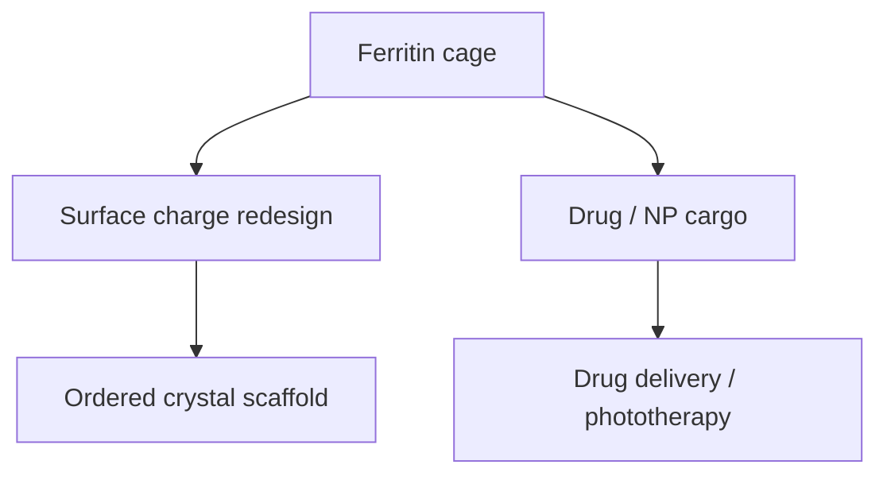

# Ferritin

Ferritin is a natural protein container for iron storage [L9, p.14]. It is described as a hollow, highly symmetric protein assembly with heavy chains (H) containing ferroxidase centres and light chains (L) containing nucleation centres [L9, p.14]. Electrostatic gradients funnel positively charged iron ions into the cavity, where Fe$^{2+}$ is oxidized and stored as a less toxic ferric mineral core [L9, p.14].

*Takeaway: ferritin spatially organizes transport, oxidation and mineral storage in one protein cage [L9, p.14].*

## Chemistry
The lecture states that H chains catalyse rapid Fe$^{2+}$ oxidation to Fe$^{3+}$, lowering toxicity and preparing iron for storage [L9, p.14]:

$$\mathrm{Fe^{2+}\rightarrow Fe^{3+}+e^-}$$

| Symbol | Meaning | Units / notes |
|---|---|---|
| $\mathrm{Fe^{2+}}$ | ferrous iron | mol L$^{-1}$ |
| $\mathrm{Fe^{3+}}$ | ferric iron | mol L$^{-1}$ |
| $e^-$ | electron transferred to oxidant | charge |

Assumptions: shown as a half-reaction; physiological ferritin mineralization requires oxidants and hydrolysis.

## Links
The empty shell is [[apoferritin]], used in [[nanoparticle-synthesis-in-nanoreactors]].

## Lectures 11 and 13 extension — ordered crystals and nanomedicine
Lecture 11 uses ferritin-like protein containers as redesignable charged building blocks for [[protein-crystal-nanoparticle-superlattices]]: changing surface charges can alter crystallisation contacts, while internal nanoparticle cargo can be positioned by the protein lattice [L11, pp.2–5]. Lecture 13 then uses ferritin as a biomedical carrier for doxorubicin, photosensitizers, CuS nanoparticles and targeting peptides [L13, pp.18–20].

*Takeaway: ferritin bridges ordered materials in L11 and therapeutic protein nanocarriers in L13.*
