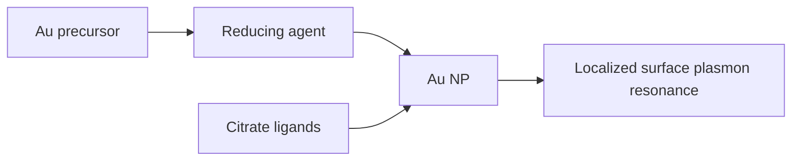
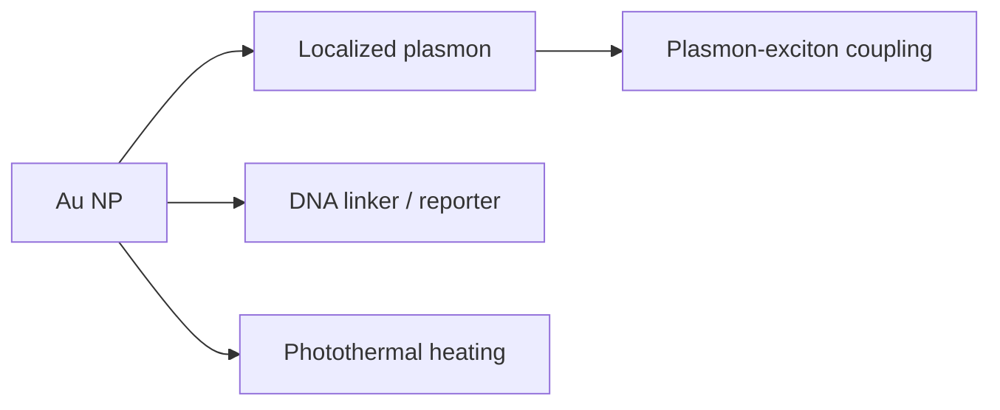

# Gold Nanoparticles

Gold nanoparticles are the lecture 5 example for noble-metal colloids. Citrate can stabilise Au nanoparticles and act as a weak reducing agent [L5, p.11]. Their optical properties arise from [[localized-surface-plasmon-resonance]], where incident light drives conduction-electron oscillations [L5, p.11].

*Takeaway: Au nanoparticle colour couples wet chemistry to collective electron motion.*

The notes say transmitted light appears red and reflected light green for the example [L5, p.11].

## Lecture 11–13 extension — assembly and medicine
Lecture 11 uses gold nanoparticles as plasmonic building blocks for [[plasmon-exciton-coupling]], DNA-mediated assemblies and protein/DNA hybrid superlattices [L11, pp.6–7]. Lecture 13 returns to gold nanomaterials in nanomedicine, noting size-dependent [[nanotoxicity]] and [[photothermal-therapy]]/diagnostic use [L13, p.20].

*Takeaway: the same Au plasmon physics supports optical coupling, programmable assembly and biomedical readout [L11, pp.6–7; L13, p.20].*

Related: [[gold-nanorods]], [[localized-surface-plasmon-resonance]], [[photothermal-therapy]], [[nanotoxicity]], [[dna-mediated-nanoparticle-assembly]], [[dna-nanorobots]] and [[nanoparticle-drug-delivery]].
