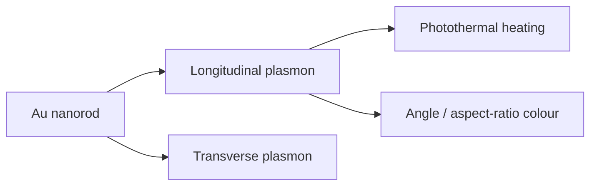

# Gold Nanorods

Gold nanorods are anisotropic gold nanoparticles whose [[localized-surface-plasmon-resonance]] response depends on aspect ratio. Lecture 12 mentions gold nanorod arrays made by electron-beam lithography plus electrophoretic deposition, where scattered-light colour changes with viewing angle [L12, p.16]. Lecture 13 uses gold nanorods/gold nanoparticles in [[photothermal-therapy]] and notes size-dependent gold nanoparticle [[nanotoxicity]] [L13, pp.19–20].

*Takeaway: nanorod anisotropy adds a geometry-tunable plasmon mode useful for optical heating and colour [L12, p.16; L13, p.20].*

## Physics
For a rod-like particle, the plasmon frequency is shape-dependent:

$$\omega_{\mathrm{LSPR}}\approx \omega_p\sqrt{\frac{L}{\varepsilon_m+L(\varepsilon_\infty-\varepsilon_m)}}$$

| Symbol | Meaning | Units / notes |
|---|---|---|
| $\omega_{\mathrm{LSPR}}$ | localized plasmon angular frequency | rad s$^{-1}$ |
| $\omega_p$ | bulk plasma frequency | rad s$^{-1}$ |
| $L$ | depolarisation factor along an axis | dimensionless |
| $\varepsilon_m$ | medium dielectric constant | dimensionless |
| $\varepsilon_\infty$ | high-frequency metal dielectric contribution | dimensionless |

Assumptions and limits: outside-the-lecture schematic ellipsoid model. It explains why changing aspect ratio or environment shifts gold nanorod optical response; the scan itself states angle-dependent scattered light and photothermal use [L12, p.16; L13, p.20].

## Links
Related to [[gold-nanoparticles]], [[localized-surface-plasmon-resonance]], [[photothermal-therapy]], [[plasmon-exciton-coupling]], [[electron-beam-lithography]] and [[nanoparticle-drug-delivery]].

