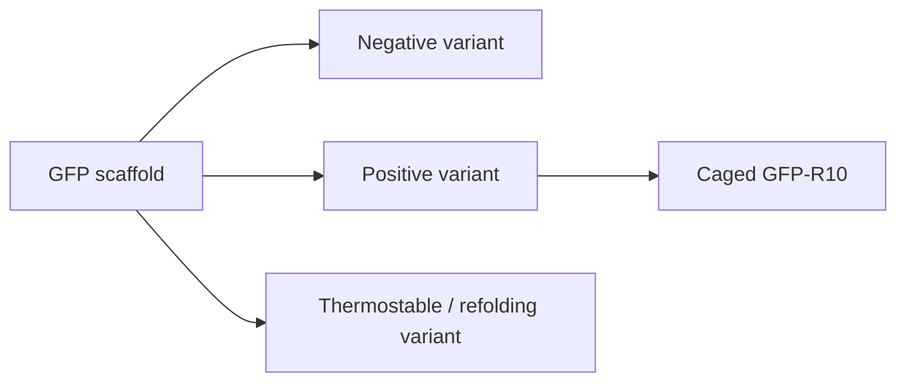

---
title: Green Fluorescent Protein
type: material
tags: [gfp, fluorescent-protein, redesign]
lectures: [L02]
updated: 2026-10-19
status: draft
---

# Green Fluorescent Protein

GFP appears as a redesign example in lecture 2. The notes compare charge variants such as HActS-neg, GFP-R10, caged GFP-R10 and GFP(+36)/GFP(+48), and state that supercharged variants can remain soluble and recover fluorescence after heating near 100 °C [L2, pp.9,12].

*Takeaway: surface charge redesign can tune protein solubility, stability and assembly behaviour.*

## Links
Example for [[rational-protein-design]], [[rosetta-protein-design]], [[protein-structure]] and [[protein-cages]].
