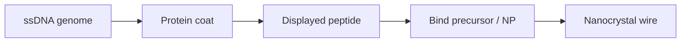

# M13 Bacteriophage

M13 is a filamentous bacteriophage that infects E. coli and has a single-stranded DNA genome surrounded by a protein coat [L10, p.19]. Because the genome can be modified to display peptides on the surface, M13 can act as a template for nanomaterial synthesis and assembly [L10, p.19].

*Takeaway: genetic modification converts a phage surface into a programmable inorganic-binding template [L10, p.19].*

## Physics / chemistry
Peptide affinity creates selective adsorption:

$$\theta=\frac{Kc}{1+Kc}$$

| Symbol | Meaning | Units / notes |
|---|---|---|
| $\theta$ | fraction of occupied binding sites | dimensionless |
| $K$ | binding association constant | L mol$^{-1}$ |
| $c$ | precursor or nanoparticle concentration | mol L$^{-1}$ |

Assumptions: Langmuir one-site model, outside-the-lecture context for phage-display affinity selection. Real phage surfaces have many repeats and multivalent binding [L10, p.19].

## Links
Used through [[phage-display]] in [[microbial-nanomaterial-synthesis]].

