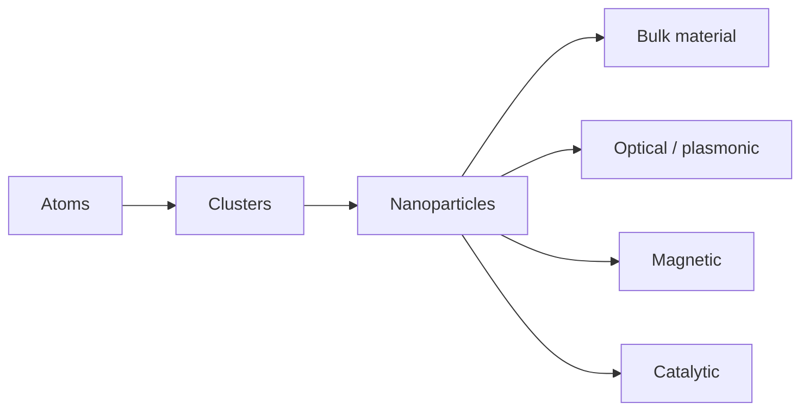
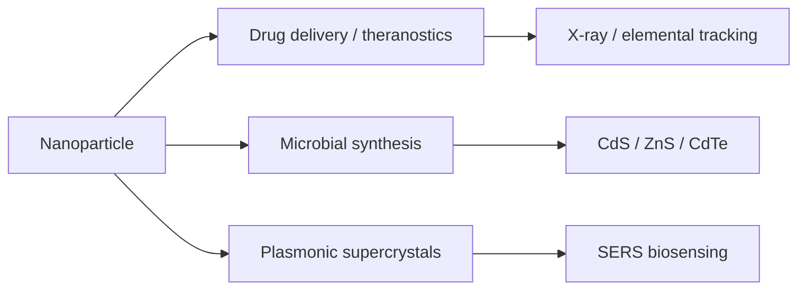

---
title: Nanoparticles
type: material
tags: [nanoparticles, colloids, surface]
lectures: [L05, L06, L07, L10]
updated: 2026-10-19
status: draft
---

# Nanoparticles

Nanoparticles are materials between bulk solids and individual molecules; they are not atomically precise because they do not contain a fixed number of atoms in a perfectly defined arrangement [L5, p.6]. Lecture 5 lists fluorescence, magnetism, plasmonics and catalysis as possible properties [L5, p.6].

*Takeaway: nanoparticles occupy the surface-dominated mesoscale.*

Their stability and size are checked later by [[dynamic-light-scattering]] and [[zeta-potential]] [L6, pp.17–21].

## Lecture 7 and 10 extensions
Lecture 7 places nanoparticles in [[nanoparticle-drug-delivery]], where high surface-to-volume ratio enables drug loading, targeting, controlled release and theranostics, but also requires ADME/toxicity monitoring [L7, p.3]. Lecture 10 adds [[microbial-nanomaterial-synthesis]], in which whole cells, phages and biofilms create or arrange nanoparticles under mild aqueous conditions [L10, pp.16–20].

*Takeaway: later lectures shift nanoparticles from isolated colloids to biological carriers, microbial products and ordered optical materials.*
