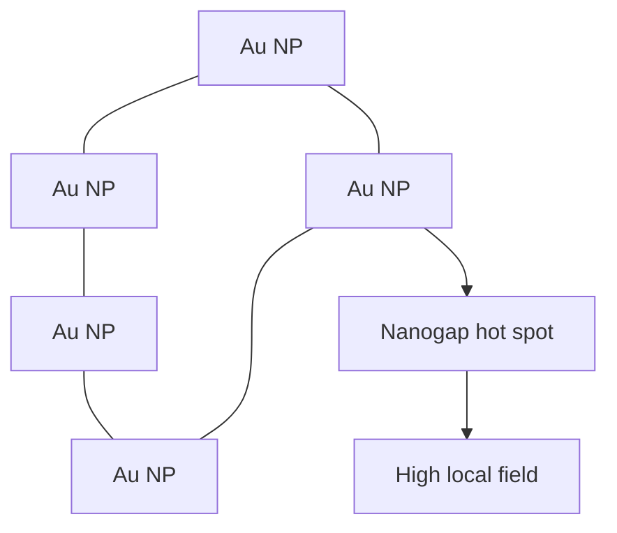

# Plasmonic Supercrystals

Plasmonic supercrystals are ordered arrays of nanoparticles arranged in periodic nanoscale structures similar to atomic crystals but built from nanoparticle units [L10, pp.21–22]. The lecture states that arrangement into superlattices can create novel properties; for noble metals such as gold, plasmonic coupling produces localized hot spots [L10, pp.21–22].

*Takeaway: ordered NP spacing converts individual plasmon resonances into collective hot spots [L10, pp.21–22].*

## Physics
Plasmonic coupling depends strongly on interparticle gap:

$$E_{\mathrm{gap}}\uparrow \quad \text{as} \quad g\downarrow$$

| Symbol | Meaning | Units / notes |
|---|---|---|
| $E_{\mathrm{gap}}$ | local electric field in the nanogap | V m$^{-1}$ |
| $g$ | interparticle gap distance | nm |

Assumptions: qualitative near-field relation; exact enhancement depends on particle size, shape, dielectric environment and excitation wavelength.

## Requirements
The lecture lists short distances, periodic arrangement and structural diversity as requirements for useful superlattice formation [L10, p.22]. Building blocks include organic ligands and DNA ligands [L10, p.22].

## Links
Used for [[sers-biosensing]] and connected to [[gold-nanoparticles]] and [[dna-mediated-nanoparticle-assembly]].

