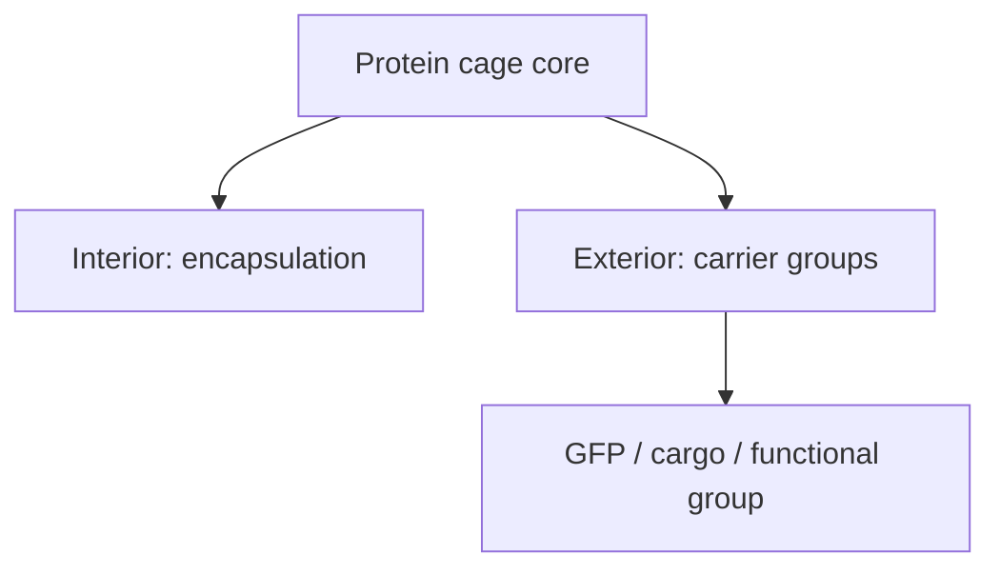
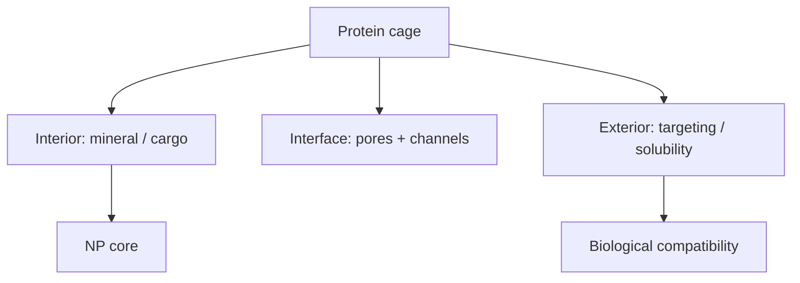
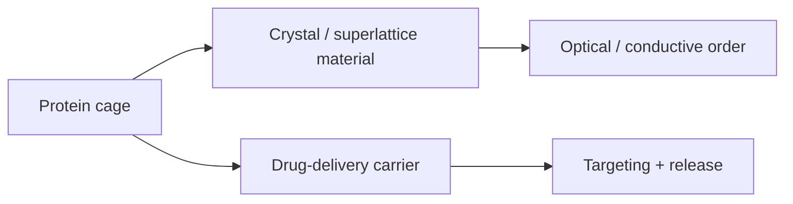

---
title: Protein Cages
type: material
tags: [protein-cage, nanocontainer, scaffold]
lectures: [L02, L09, L11, L13]
updated: 2026-10-19
status: draft
---

# Protein Cages

Protein cages are protein-based structures with an interior that can encapsulate molecules and an exterior that can display carrier groups [L2, p.9]. The scan highlights symmetry, stability, efficient assembly, functional efficiency and energetic favourability; cowpea is noted as an example around 31 nm [L2, p.9].

*Takeaway: protein cages spatially separate inside cargo from outside display chemistry.*

## Design relevance
Cages are attractive biohybrid scaffolds because symmetry helps assembly and because their inside/outside surfaces can be functionalised differently [L2, p.9].

## Links
Related to [[proteins]], [[rational-protein-design]], [[enzyme-production-in-e-coli]] and [[protein-engineering-drug-delivery]].

## Lecture 9 extension — natural nanoreactors
Lecture 9 reuses protein cages as natural and artificial nanoreactors. Protein containers are described as spherical assemblies made from modular building blocks, with hollow interiors, high symmetry and distinct interior/interface/exterior surfaces [L9, p.14]. [[ferritin]] stores iron naturally, while [[apoferritin]] can template iron oxide, silver, PbS and quantum-dot-like products [L9, pp.14–15].

*Takeaway: protein cages divide nanoreactor function between inner cavity, transport interface and outer biological surface [L9, pp.14–15].*

## Lectures 11 and 13 extension — crystals and carriers
Lecture 11 treats cages as programmable building blocks for ordered hybrid materials: surface-charge redesign controls assembly, crystallisation screens find ordered packing, and nanoparticle cargo can be placed inside the scaffold [L11, pp.2–5]. Lecture 13 treats the same cage logic as nanomedicine: the outside can carry targeting groups, while the inside carries drugs, photosensitizers or inorganic nanoparticles [L13, pp.18–20].

*Takeaway: protein cages are reusable architecture: materials science changes the lattice, medicine changes the cargo and targeting shell [L11, pp.2–5; L13, pp.18–20].*
