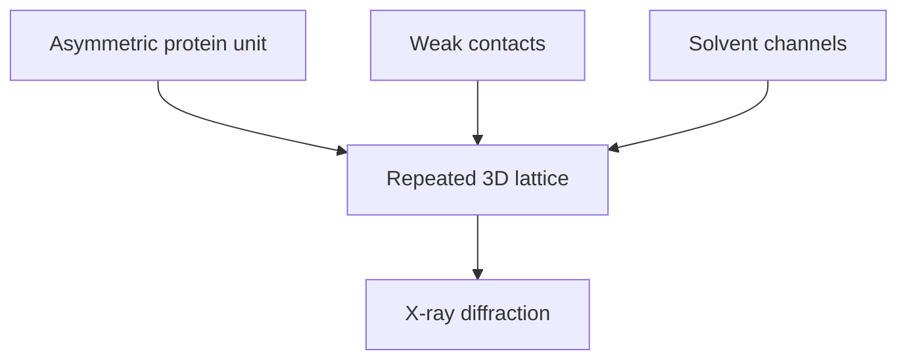

---
title: Protein Crystals
type: material
tags: [protein-crystal, crystallography]
lectures: [L03]
updated: 2026-10-19
status: draft
---

# Protein Crystals

Protein crystals are described as regular, homogeneous 3D arrangements of proteins with weak interactions such as hydrogen bonds, electrostatics and van der Waals contacts; they are usually fragile and contain large amounts of solvent [L3, p.13].

*Takeaway: a protein crystal is an ordered but hydrated and weakly held array of biomolecules.*

## Links
Analysed by [[protein-crystallography]], [[x-ray-diffraction]], [[bragg-law]] and [[crystallographic-symmetry]].
