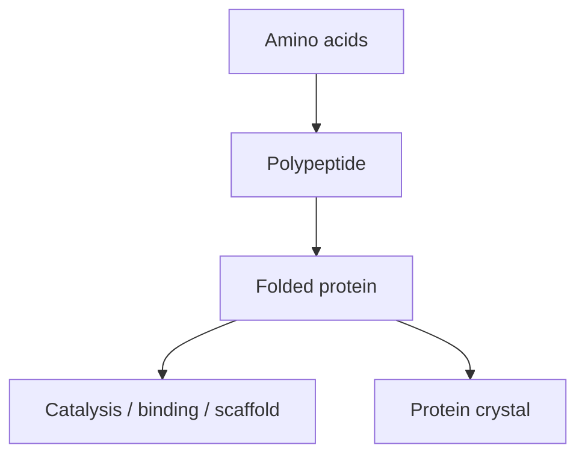

---
title: Proteins
type: material
tags: [protein, biomolecule]
lectures: [L01, L02, L03]
updated: 2026-10-19
status: draft
---

# Proteins

Proteins are presented as biomolecules with defined 3D structures, amino-acid building blocks and hierarchical structures from sequence to quaternary assembly [L1, p.2]. They serve as catalysts, scaffolds, cages, crystallisation targets and design substrates across lectures 1–3.

*Takeaway: proteins are both functional molecules and programmable nanoscale building blocks.*

## Key features
- Made from mostly L-amino acids in nature [L1, p.4].
- Stabilised by hydrogen bonds, electrostatics, van der Waals contacts and hydrophobic effects [L1, p.3].
- Can be engineered by [[rational-protein-design]] or [[directed-evolution]] [L2, pp.7,9,12].

## Links
See [[amino-acids-peptides]], [[protein-structure]], [[protein-folding-thermodynamics]], [[protein-cages]] and [[protein-crystals]].
