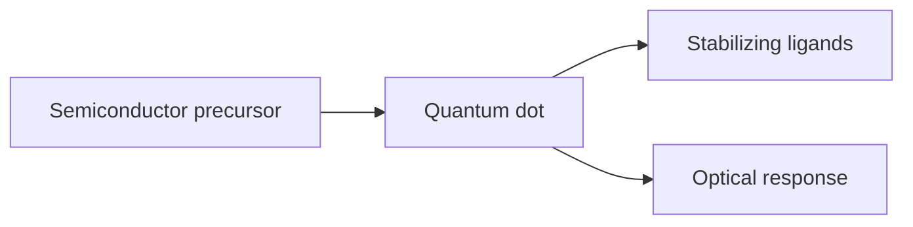
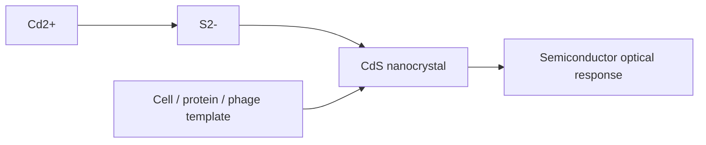

---
title: Quantum Dots
type: material
tags: [semiconductor, nanocrystals, photoluminescence]
lectures: [L05, L09, L10]
updated: 2026-10-19
status: draft
---

# Quantum Dots

Quantum dots are mentioned as semiconductor nanoparticles made by hot injection [L5, p.15]. The notes position them as nanocrystals whose size is controlled by nucleation and growth rather than giving band-gap equations.

*Takeaway: in this lecture, quantum dots are a hot-injection synthesis example.*

Quantum-confinement equations are outside the lecture material.

## Lecture 9–10 extension — bio-produced semiconductor nanocrystals
Lecture 9 lists quantum-dot-like products among materials that can be made in [[apoferritin]] nanoreactors [L9, p.15]. Lecture 10 then shifts to biological synthesis of semiconductor nanocrystals such as CdS, ZnS and CdTe in yeast, E. coli, Shewanella systems, halophiles and [[m13-bacteriophage]] templates [L10, pp.17–20].

*Takeaway: biological matrices can act as reaction media and templates for semiconductor nanocrystals [L10, pp.17–20].*

### Net precipitation
$$\mathrm{Cd^{2+}+S^{2-}\rightarrow CdS(s)}$$

| Symbol | Meaning | Units / notes |
|---|---|---|
| $\mathrm{Cd^{2+}}$ | cadmium precursor | mol L$^{-1}$ |
| $\mathrm{S^{2-}}$ | sulfide precursor | mol L$^{-1}$ |
| $\mathrm{CdS(s)}$ | cadmium sulfide nanocrystal | solid |

Assumptions: net reaction only; in cells, phytochelatins, proteins, transport and local compartments alter nucleation and growth.
