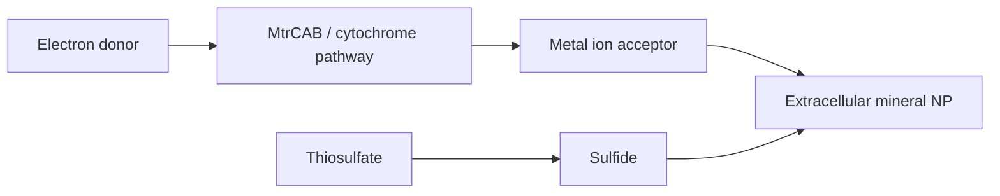

# Shewanella oneidensis

Shewanella oneidensis is used in the lecture as an anaerobic bacterium for dissimilatory metal reduction and extracellular nanomaterial formation [L10, pp.18–19]. The notes connect Shewanella to reduction of metal ions and to arsenic sulfide nanoparticle formation outside cells, templated by polysaccharides [L10, p.19].

*Takeaway: Shewanella couples microbial electron transfer to extracellular mineral precipitation [L10, pp.18–19].*

## Chemistry
The scan gives the redox directions:

$$\mathrm{As(V)\rightarrow As(III)},\qquad \mathrm{S_2O_3^{2-}\rightarrow S^{2-}}$$

| Symbol | Meaning | Units / notes |
|---|---|---|
| $\mathrm{As(V)}$ | arsenate oxidation state | dissolved precursor |
| $\mathrm{As(III)}$ | reduced arsenic state | dissolved/product precursor |
| $\mathrm{S_2O_3^{2-}}$ | thiosulfate | mol L$^{-1}$ |
| $\mathrm{S^{2-}}$ | sulfide | mol L$^{-1}$ |

Assumptions: not balanced; the lecture notes the biological reduction but not the complete pathway.

## Links
Part of [[microbial-nanomaterial-synthesis]] and linked to [[biomineralization]].

