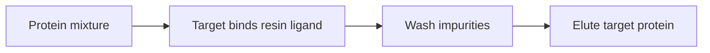

---
title: Affinity Chromatography
type: method
tags: [chromatography, purification, affinity]
lectures: [L01]
updated: 2026-10-19
status: draft
---

# Affinity Chromatography

Affinity chromatography separates proteins by binding to immobilised ligands or tags. The lecture notes list it as a purification method based on affinity of chemical groups and mention high selectivity but the need for an affinity tag [L1, p.6].

*Takeaway: affinity purification trades high selectivity for tag/ligand dependence.*

## Parameters
Ligand identity, tag accessibility, buffer pH/salt and elution condition determine yield and purity. It is usually one step in a multi-method workflow [L1, p.8].

## Links
Used after [[recombinant-protein-production]] and before [[protein-crystallography]].
