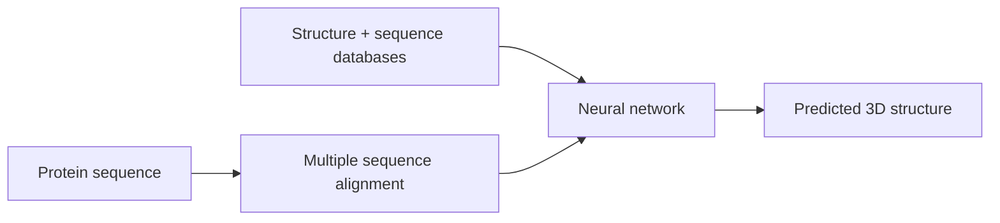

---
title: AlphaFold
type: method
tags: [protein-structure, ai, prediction]
lectures: [L04]
updated: 2026-10-19
status: draft
---

# AlphaFold

AlphaFold is presented as an AI method that predicts a protein 3D structure from sequence and multiple sequence alignments using large structure/sequence databases [L4, pp.4–5].

*Takeaway: AlphaFold maps sequence information to fold hypotheses.*

The lecture still treats experimental structure methods as needed for validation [L4, p.5].

