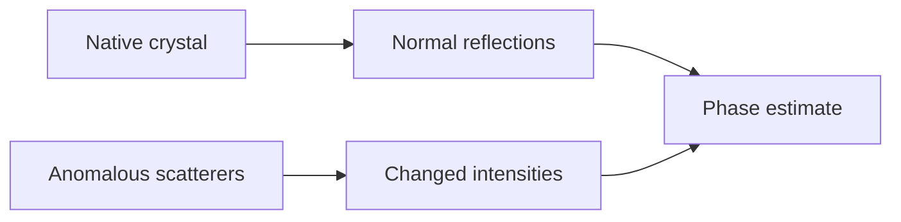

---
title: Anomalous Dispersion
type: method
tags: [crystallography, phasing, x-ray]
lectures: [L04]
updated: 2026-10-19
status: draft
---

# Anomalous Dispersion

Anomalous dispersion is listed as a route to extra phasing information by making atoms scatter X-rays differently, for example using heavy atoms or edge effects [L4, p.1].

*Takeaway: anomalous differences add independent information to solve phases.*

