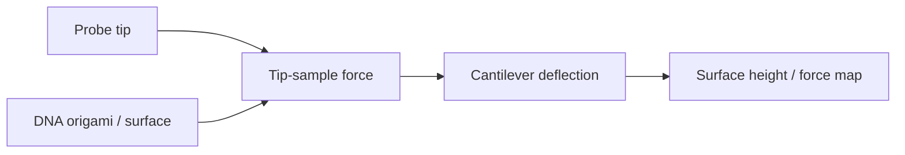

# Atomic Force Microscopy

Atomic force microscopy (AFM) scans a sharp probe tip across a surface and detects tip-sample force through cantilever deflection [L12, p.9]. Lecture 12 uses AFM to visualise DNA origami and surface nanostructures, with Si/Si$_3$N$_4$ probe tips and force readout from the cantilever [L12, p.9].

*Takeaway: AFM maps surfaces mechanically, complementing electron and tunnelling methods [L12, p.9].*

## Physics
The scan writes the force law:

$$F=k\Delta z$$

| Symbol | Meaning | Units / notes |
|---|---|---|
| $F$ | tip-sample force | N |
| $k$ | cantilever spring constant | N m$^{-1}$ |
| $\Delta z$ | cantilever deflection | m |

Assumptions and limits: Hooke-law readout for small deflections. Real AFM contrast also depends on adhesion, capillary forces, feedback mode and tip shape [L12, p.9].

## Links
Related to [[dna-origami]], [[scanning-tunneling-microscopy]] and [[electron-beam-lithography]].

