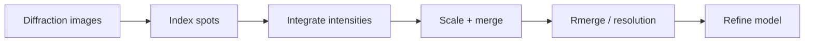

---
title: Crystallographic Data Processing
type: method
tags: [crystallography, data-processing, validation]
lectures: [L04]
updated: 2026-10-19
status: draft
---

# Crystallographic Data Processing

Lecture 4 lists indexing, integration, scaling, merging, validation, resolution assessment and refinement/deposition [L4, pp.1–4]. Reflections are indexed, each spot is integrated, symmetry-related observations are merged and $R_{\mathrm{merge}}$ indicates data quality [L4, p.2].

$$R_{\mathrm{merge}}=\frac{\sum_{hkl}\sum_i |I_i(hkl)-\langle I(hkl)\rangle|}{\sum_{hkl}\sum_i I_i(hkl)}$$

| Symbol | Meaning | Units / notes |
|---|---|---|
| $I_i(hkl)$ | $i$th intensity measurement | counts |
| $\langle I(hkl)\rangle$ | merged mean intensity | counts |
| $R_{\mathrm{merge}}$ | agreement metric | dimensionless or % |

*Takeaway: raw images become a validated intensity table and model.*

