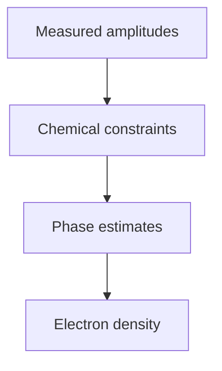

---
title: Direct Methods
type: method
tags: [crystallography, phasing]
lectures: [L04]
updated: 2026-10-19
status: draft
---

# Direct Methods

Direct methods are listed as algorithms that use reproducibility and known chemical constraints to estimate phases [L4, p.1].

*Takeaway: direct methods infer phases from mathematical and chemical consistency.*

The notes do not give a named algorithm or equation; none is inferred [L4, p.1].

