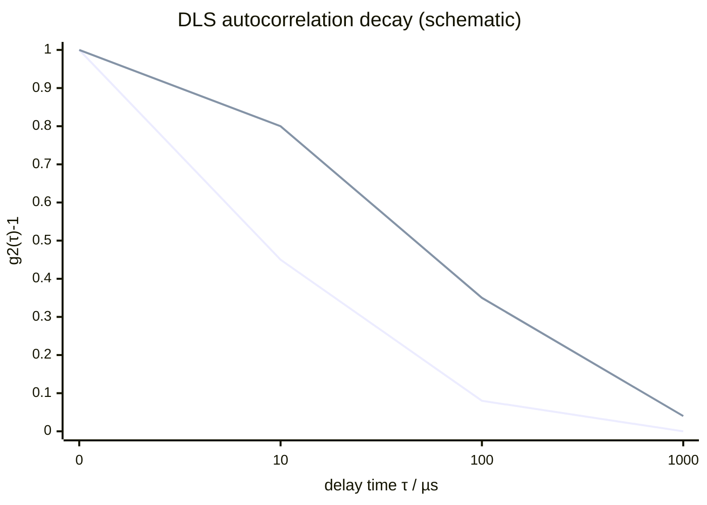

# Dynamic Light Scattering

Dynamic light scattering (DLS) determines size distributions of particles or polymers in solution by measuring time-dependent scattered-light fluctuations from [[brownian-motion]] [L6, pp.18–20].

$$g^{(2)}(\tau)=\frac{\langle I_{det}(t)I_{det}(t+\tau)\rangle}{\langle I_{det}(t)\rangle^2}$$

| Symbol | Meaning | Units / notes |
|---|---|---|
| $g^{(2)}(\tau)$ | intensity autocorrelation | dimensionless |
| $I_{det}$ | detector intensity | counts s$^{-1}$ |
| $\tau$ | delay time | s or µs |

*Takeaway: faster decay means faster diffusion and smaller hydrodynamic size.*

