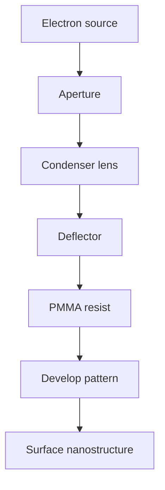

# Electron-Beam Lithography

Electron-beam lithography (EBL) writes nanostructures on surfaces with a focused electron beam [L12, p.16]. The scan lists sub-10 nm resolution, solubility changes in the resist, low throughput, high vacuum and special resist requirements, especially PMMA [L12, p.16].

*Takeaway: EBL trades very high resolution for serial writing and demanding process conditions [L12, p.16].*

## Physics
Resolution is limited by beam size and scattering:

$$w_{\mathrm{eff}}^2\approx w_0^2+w_{\mathrm{scatter}}^2+w_{\mathrm{process}}^2$$

| Symbol | Meaning | Units / notes |
|---|---|---|
| $w_{\mathrm{eff}}$ | effective written feature width | nm |
| $w_0$ | focused beam diameter | nm |
| $w_{\mathrm{scatter}}$ | broadening by electron scattering/proximity | nm |
| $w_{\mathrm{process}}$ | resist/development broadening | nm |

Assumptions and limits: outside-the-lecture schematic. The lecture emphasises qualitative trade-offs: high resolution, but low throughput and resist/substrate constraints [L12, p.16].

## Biohybrid example
Lecture 12 notes EBL plus electrophoretic deposition of gold nanorods, yielding arrays whose scattered light depends on viewing angle [L12, p.16].

## Links
Related to [[electron-microscopy]], [[scanning-electron-microscopy]], [[gold-nanorods]] and [[langmuir-blodgett-films]].

