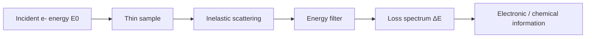

# Electron Energy Loss Spectroscopy

Electron energy loss spectroscopy (EELS) detects the energy lost by electrons after inelastic scattering in a thin sample [L8, p.7]. The lecture notes that an energy filter and detector determine energy loss, giving information about electronic structure, chemical composition and nearest-neighbour atoms; it is especially useful for lighter atoms [L8, p.7].

*Takeaway: EELS reads what energy electrons lose inside the specimen [L8, p.7].*

## Physics
$$\Delta E=E_0-E_1$$

| Symbol | Meaning | Units / notes |
|---|---|---|
| $\Delta E$ | electron energy loss | eV |
| $E_0$ | incident electron energy | eV or keV |
| $E_1$ | transmitted electron energy after interaction | eV or keV |

Assumptions: thin samples reduce plural scattering; interpretation depends on energy resolution, thickness and beam damage.

## Links
Used with [[transmission-electron-microscopy]] and contrasted with [[energy-dispersive-x-ray-spectroscopy]].

