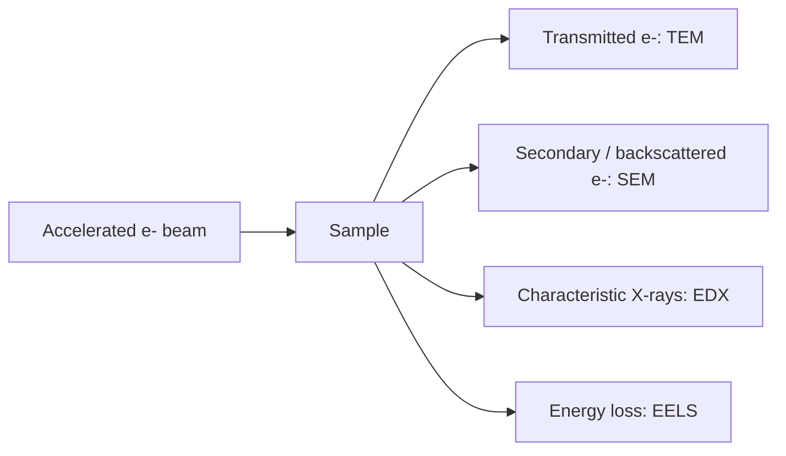

# Electron Microscopy

Electron microscopy uses accelerated electrons as a short-wavelength probe for high-resolution imaging [L8, p.7]. The lecture emphasizes that electrons scatter strongly, heavy atoms give more contrast, biological samples often lack heavy atoms, and samples must tolerate vacuum and electron dose [L8, pp.7–10].

*Takeaway: electron microscopy is a platform that branches into imaging and spectroscopic signals [L8, pp.7–11].*

## Physics
Resolution is linked to electron wavelength:

$$\lambda=\frac{h}{p}$$

| Symbol | Meaning | Units / notes |
|---|---|---|
| $\lambda$ | electron de Broglie wavelength | m |
| $h$ | Planck constant | J s |
| $p$ | electron momentum | kg m s$^{-1}$ |

Assumptions: wave-particle description of electrons; practical resolution is limited by lenses, aberrations, dose and sample stability.

## Links
Includes [[transmission-electron-microscopy]], [[scanning-electron-microscopy]], [[energy-dispersive-x-ray-spectroscopy]], [[electron-energy-loss-spectroscopy]] and [[cryo-em]].

