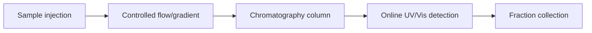

---
title: Fast Protein Liquid Chromatography
type: method
tags: [fplc, chromatography, automation]
lectures: [L01]
updated: 2026-10-19
status: draft
---

# Fast Protein Liquid Chromatography

Fast protein liquid chromatography (FPLC) is presented as highly automated, with sample injection, flow control, gradients, setup and sample collection; online UV/Vis detection is noted [L1, p.8].

*Takeaway: FPLC automates multi-step protein purification and monitoring.*

## Example
The scan gives overexpression in *E. coli* followed by pre-purification and FPLC [L1, p.8].

## Links
Coordinates [[affinity-chromatography]], [[ion-exchange-chromatography]], [[hydrophobic-interaction-chromatography]] and [[size-exclusion-chromatography]].
