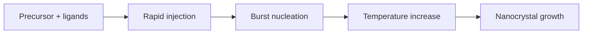

---
title: Hot Injection
type: method
tags: [quantum-dots, nanocrystals, synthesis]
lectures: [L05]
updated: 2026-10-19
status: draft
---

# Hot Injection

Hot injection is described for quantum dots: a precursor-ligand solution remains stable, then injection and heating create many nuclei followed by particle growth [L5, p.15].

*Takeaway: burst nucleation followed by growth aims to narrow nanocrystal sizes.*

Key requirements are solubility, thermal stability and ligand-based stabilisation/functionality [L5, p.15].

