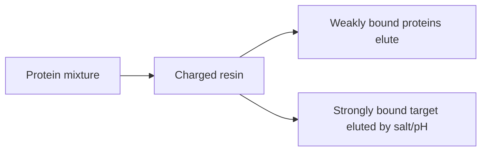

---
title: Ion Exchange Chromatography
type: method
tags: [chromatography, charge, purification]
lectures: [L01]
updated: 2026-10-19
status: draft
---

# Ion Exchange Chromatography

Ion exchange chromatography separates proteins by surface charge. The notes draw a charged column and oppositely charged proteins, with blue/red marking positive/negative proteins [L1, p.6].

*Takeaway: changing salt or pH tunes electrostatic binding to the column.*

## Key relation
Charge depends on solution pH relative to the protein isoelectric point pI; at pH near pI net charge is low. The pI concept is explicitly noted in lecture 3 as the pH where a protein has no net charge [L3, p.23].

## Links
Connects [[recombinant-protein-production]], [[salting-in-salting-out]] and [[protein-crystallization-phase-diagram]].
