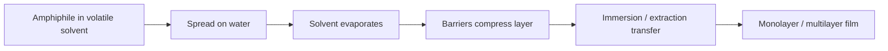

# Langmuir-Blodgett Films

Langmuir-Blodgett (LB) films form by spreading amphiphilic molecules at an air-water interface, compressing the monolayer with barriers and transferring it to a substrate by immersion or extraction [L12, p.15]. The lecture notes that the method also works with particles such as SiO$_2$ particle layers and photonic crystals, and that stable monolayers can be produced by mechanical pressure [L12, p.13].

*Takeaway: LB deposition controls monolayer packing before moving it onto a solid surface [L12, p.15].*

## Surface pressure
The compression state is often described by surface pressure:

$$\Pi=\gamma_0-\gamma$$

| Symbol | Meaning | Units / notes |
|---|---|---|
| $\Pi$ | surface pressure | N m$^{-1}$ or mN m$^{-1}$ |
| $\gamma_0$ | surface tension of clean subphase | N m$^{-1}$ |
| $\gamma$ | surface tension with monolayer | N m$^{-1}$ |

Assumptions and limits: outside-the-lecture equation for the scan’s barrier-compression sketch. It treats the monolayer as a 2D film; collapse, multilayers and particle roughness complicate transfer [L12, p.15].

## Parameters
Lecture 12 names polarity of the end group, pH, temperature and length of the nonpolar chain ($n>11$) as important LB parameters [L12, p.13].

## Links
Related to [[self-assembled-monolayers]], [[superhydrophobicity-lotus-effect]], [[scanning-tunneling-microscopy]] and [[electron-beam-lithography]].

