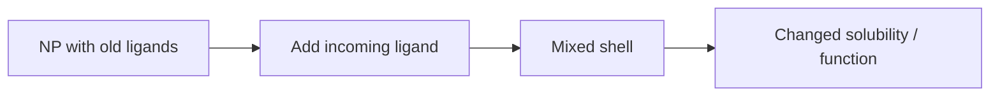

---
title: Ligand Exchange
type: method
tags: [nanoparticles, ligands, surface-modification]
lectures: [L05]
updated: 2026-10-19
status: draft
---

# Ligand Exchange

Ligand exchange modifies a nanoparticle surface without changing the core. Lecture 5 describes phase-transfer reactions and ligand exchange on solid supports for Janus-type particles [L5, p.15].

$$\mathrm{[NP{-}L_x]+L'\rightarrow[NP{-}L'_x]+L}$$

| Symbol | Meaning | Units / notes |
|---|---|---|
| NP | nanoparticle core | nm-scale solid |
| $L$ | old ligand | surface-bound molecule |
| $L'$ | incoming ligand | solubility/function control |

*Takeaway: surface chemistry can transfer particles between phases [L5, p.15].*

